# PC2Products Tools

**PC2Products** (Point Cloud to Products) is part of BERA Tools' category for turning LiDAR point clouds
(`.las` / `.laz`) into raster products such as a **DTM**, **DSM**, **CHM** and **hummock/hollow**
maps. It also includes tools for checking the input data and for classifying ground points before you
process it.

Each tool is a thin Python wrapper in `beratools/tools/`. It validates the inputs and then calls an
R function in `r_scripts_collection.r` through [rpy2](https://rpy2.github.io/). The R functions use
[lidR](https://r-lidar.github.io/lidRbook/) to do the processing. The tools appear under the
**PC2Products** category in the BERA Tools GUI, which is defined in
`beratools/gui/assets/beratools.json`.

### Documentation

The **[PC2Products Guide](https://appliedgrg.github.io/PC2Products/)** covers each tool on its own page
(source in [`docs/`](docs/)):

- [User Guide](https://appliedgrg.github.io/PC2Products/user_guide/): the typical workflow and how to run the tools from the GUI,
  the `bt` command or Python
- [Installation](https://appliedgrg.github.io/PC2Products/user/installation/)
- [Overview of the tools](https://appliedgrg.github.io/PC2Products/overview/), with links to a page per tool
- [Technical Guide](https://appliedgrg.github.io/PC2Products/technical_guide/): how the tools run and how R is located

To build the site locally, run `pixi run zensical build -f docs/mkdocs.yml` (output in `docs/site/`), or
`pixi run zensical serve -f docs/mkdocs.yml` to preview it.


*Rasters produced from the sample tiles in `tests/data/LiDAR/` (ground-classified with CSF first, cell
size 0.3 m). Top: DTM and DSM, both built with TIN. Bottom: the hummock/hollow tool's two outputs,
using `Smooth_by = median`, `Min_ws = 3` and `lawn_range = 0.1`.*

| Tool | Module | Python function | R function(s) |
|------|--------|-----------------|---------------|
| [LiDAR data info](#lidar-data-info) | `rpy_las_info.py` | `rpy_las_info` | `las_info` |
| [Raster Cell size from LiDAR data](#raster-cell-size-from-lidar-data) | `rpy_find_cellsize.py` | `rpy_find_cellsize` | `pd2cellsize` |
| [Ground Classify Using CSF](#ground-classify-using-csf) | `rpy_gnd_csf.py` | `rpy_gnd_csf` | `classify_gnd_csf` |
| [Generate DTM from LiDAR Data](#generate-dtm-from-lidar-data) | `rpy_dtm_by.py` | `rpy_dtm` | `dtm_by_tin`, `dtm_by_knnidw`, `dtm_by_kriging` |
| [Normalize LiDAR Data](#normalize-lidar-data) | `rpy_normalized_PC.py` | `rpy_normalized_PC` | `normalized_lidar_tin`, `normalized_lidar_knnidw`, `normalized_lidar_kriging` |
| [Generate CHM or DSM from LiDAR Data](#generate-chm-or-dsm-from-lidar-data) | `rpy_CHM_DSM_by.py` | `rpy_chm_dsm_by` | `chm_dsm_by_tin`, `chm_dsm_by_pitfree` |
| [Detect Hummock and Hollow from LiDAR Data](#detect-hummock-and-hollow-from-lidar-data) | `rpy_PC2hummock_hollow.py` | `rpy_hh2raster` | `hh_function` |
| [Surface Water Mapping](#surface-water-mapping) | `rpy_surface_water.py` | `rpy_surface_water` | `surface_water_map` |
| [Depth-to-Water from Surface Water](#depth-to-water-from-surface-water) | `rpy_dtw.py` | `rpy_dtw` | `dtw_map` |
| [Seismic Line Disturbance Analysis](#seismic-line-disturbance-analysis) | `rpy_seismic_line_analysis.py` | `rpy_seismic_line_analysis` | `seismic_line_analysis` |

Shared helpers:

| File | Contents |
|------|----------|
| `r_interface.py` | `configure_r_environment()`: finds R and sets up `R_HOME`, the DLL search path and `PATH` before rpy2 is imported, and puts rpy2 in ABI mode (see [How R is located](#how-r-is-located)). |
| `r_common.py` | Connects rpy2 on first use (hiding rpy2's start-up messages), and provides `r_processes`, `r_processes_by_memory`, `check_las_files_existence`, `check_las_out_folder_existence` and `check_r_packages_installation`. |
| `common.py` | `has_raster_output`, `has_lidar_output` and `list_files_in_folder`, used by the tests to check a tool wrote its output. `has_raster_output` takes a folder, or a list of files and an optional glob pattern such as `Merged_*_DTM.tif`. |
| `r_scripts_collection.r` | All the R processing functions, plus `detect_normalized`, `detect_class` (whether each tile has points of a given class), `mosaic_catalog_outputs`, and the tiling helpers `run_tiles`, `use_temp_dir` and `restore_temp_dir` used by Surface Water Mapping and Depth-to-Water. |

### Typical workflow

1. **LiDAR data info**: check the CRS, extent, density and whether the data is height-normalized.
2. **Raster Cell size from LiDAR data**: preview the cell size that the raster tools will use.
3. **Ground Classify Using CSF**: classify ground points if the data isn't ground-classified yet.
4. **Generate DTM from LiDAR Data**: build the bare-earth terrain model.
5. **Normalize LiDAR Data**: subtract the terrain from the point cloud, so that Z is height above
   ground.
6. **Generate CHM or DSM from LiDAR Data**: build a CHM from the normalized tiles, or a DSM from the
   original tiles.
7. **Detect Hummock and Hollow from LiDAR Data**: map micro-topography from the ground-classified data.
8. **Surface Water Mapping**: map surface water from a true-colour orthomosaic.
9. **Depth-to-Water from Surface Water**: krige a water table from the surface water and compute
   depth to water.
10. **Seismic Line Disturbance Analysis**: compare seismic lines with the surrounding peatland, using the
   DTM, hummock/hollow and depth-to-water rasters (see
   [Reproducing Chan et al. (2026)](#reproducing-chan-et-al-2026)).

---

### How all the tools behave

These points apply to the seven LiDAR tools. Surface Water Mapping, Depth-to-Water from Surface Water and
Seismic Line Disturbance Analysis work on rasters instead (see their own sections), but they install
their R packages the same way:

- **Input**: every `.las` / `.laz` file in `in_las_folder` is read as a lidR `LAScatalog`. If the
  folder is missing or holds no LAS/LAZ files, the tool prints an error naming the folder and stops.
- **Ground classification check**: the DTM and hummock/hollow tools check **every** tile with
  `detect_class(in_las_folder, 2)`. If any tile has no ground points (class 2), they print
  `[Warning!] The LiDAR data is not classified, please run ground classification first.` and stop.
- **Noise removal**: points classified as low noise (class 7) are dropped with
  `filter = "-drop_class 7"`.
- **Cell size**: the DTM, CHM/DSM and hummock/hollow tools take a `cell_size`. When it is `0` (the
  default everywhere), they calculate it from the point density, as described in
  [Raster Cell size from LiDAR data](#raster-cell-size-from-lidar-data).
- **Output folder**: if `out_folder` doesn't exist, it's created. Existing outputs are overwritten.
- **Tiled output and mosaic**: the raster tools write one raster per input tile. When there is more
  than one tile, they also merge the tiles into a single `Merged_*.tif` with `terra::mosaic`.
- **Parallel processing**: the LiDAR tools use `future::plan(multisession)` and `set_lidr_threads`.
  The number of R workers comes from `r_processes(processes)`:
  - A `processes` value of 0 or less (the default) means "use every CPU core".
  - The worker count is never more than `processes`, the number of CPU cores, or 8.
  - When more than 2 workers would be used, available memory caps the count: 2 workers with about
    50 GB or less free, and 4 workers with about 150 GB or less free.
  - lidR gets that count as its thread count, and `future` starts half as many worker sessions
    (at least 1). The kriging DTM is the exception and starts the full count.
  - The TIN and kriging DTM tools halve the count first when the cell size is under 1 map unit.
  - Every tool resets the plan to `sequential` when it finishes, even if it fails.

  Surface Water Mapping and Depth-to-Water size their workers differently (see
  [Tiled processing](#tiled-processing-for-surface-water-and-depth-to-water)).
- **Progress**: the R functions print `R_PROGRESS:<percent>` lines at each stage. The GUI reads them
  to move its progress bar and doesn't show them in the log.
- **R packages**: the environment provides only R and rpy2. Each tool checks for the R packages it
  needs and installs any missing ones from the CRAN mirror in Canada into the library of the R it
  runs on (`<R_HOME>/library`, inside the conda or pixi environment). The first run of each tool can
  therefore take a while. If a package still can't be installed, the tool stops with
  `R packages could not be installed into <library>: <names>`.

#### Tiled processing for Surface Water and Depth-to-Water

Surface Water Mapping and Depth-to-Water from Surface Water work on rasters that can be very large
(for example a 2 cm orthomosaic or a 10 cm DTM). They split the grid into square tiles of `tile_size`
cells per side and process the tiles in parallel R sessions (`run_tiles`):

- **Workers**: `r_processes_by_memory` uses the smallest of the requested `processes` (every CPU core
  when 0 or less), the number of CPU cores, the number of tiles, and how many workers fit in 60% of
  the free memory. Each worker is budgeted at 200 MB plus 100 bytes per cell of its tile. The tool
  prints the count and the limits, for example
  `R workers: 4 (smallest of: requested 16, CPU cores 16, tiles 4, free memory for 22 at 0.60 GB each)`.
  A smaller `tile_size` uses less memory per worker.
- **Progress**: the tiles run in about 20 batches. After each batch, the GUI shows
  `Surface water tiles n of N` or `Kriging tiles n of N` and updates the progress bar.
- **Temporary files**: the tiles and terra's temporary files go to a `surface_water_temp_*` or
  `dtw_temp_*` folder inside `out_folder`, not the system temp drive, because heavy temporary traffic
  there can get R killed by antivirus software. The folder is deleted when the tool finishes. If
  Windows still holds a file open, the tool prints a warning naming the folder.
- **Same result as untiled**: tiling doesn't change the output. Surface water tiles read a buffer
  wide enough to hold any patch smaller than `min_patch_area`, and each kriged cell uses only its
  `nmax` nearest water points, wherever its tile boundary falls.

---

### LiDAR data info

Prints a summary of the LiDAR dataset to the console. It doesn't write any files.

| Item | How it's calculated |
|------|---------------------|
| Data format | LAS version (`Major.Minor`) of the first file |
| CRS / EPSG / Units | `sf::st_crs` of the catalog. Reports `Unknown` if the CRS is missing. |
| Extent | min X, max X, min Y, max Y across all tiles |
| Area | Catalog area in km² |
| Total Points | Sum of the point records in all tiles |
| Density | Total points / area, in pts/m² |
| Total Files | Number of LAS/LAZ files |
| Normalized | `YES` if the mean \|Z\| of the ground points is below 1 (first file only) |
| Ground Z Range / Z Range | Min and max Z of the ground points and of all points (first file only) |

| Parameter | Type | Required | Description |
|-----------|------|----------|-------------|
| `in_las_folder` | directory | Yes | Folder containing the input LAS/LAZ tiles. |
| `processes` | int | No | Requested number of parallel workers. |

```python
from beratools.tools.rpy_las_info import rpy_las_info

rpy_las_info(in_las_folder="tests/data/LiDAR")
```


### Raster Cell size from LiDAR data

Calculates the recommended raster cell size from the average point density:

```text
point_density = total point records / catalog area
cell_size     = sqrt(3 / point_density), rounded to the nearest 0.05 map units
```

The cell size is printed along with the map units of the CRS. The R function `pd2cellsize` returns
`cell_size`, `map_units` and `point_density`, and the DTM and CHM/DSM tools call it to set their
output resolution.

| Parameter | Type | Required | Description |
|-----------|------|----------|-------------|
| `in_las_folder` | directory | Yes | Folder containing the input LAS/LAZ tiles. |
| `processes` | int | No | Requested number of parallel workers. |

```python
from beratools.tools.rpy_find_cellsize import rpy_find_cellsize

rpy_find_cellsize(in_las_folder="tests/data/LiDAR")
```

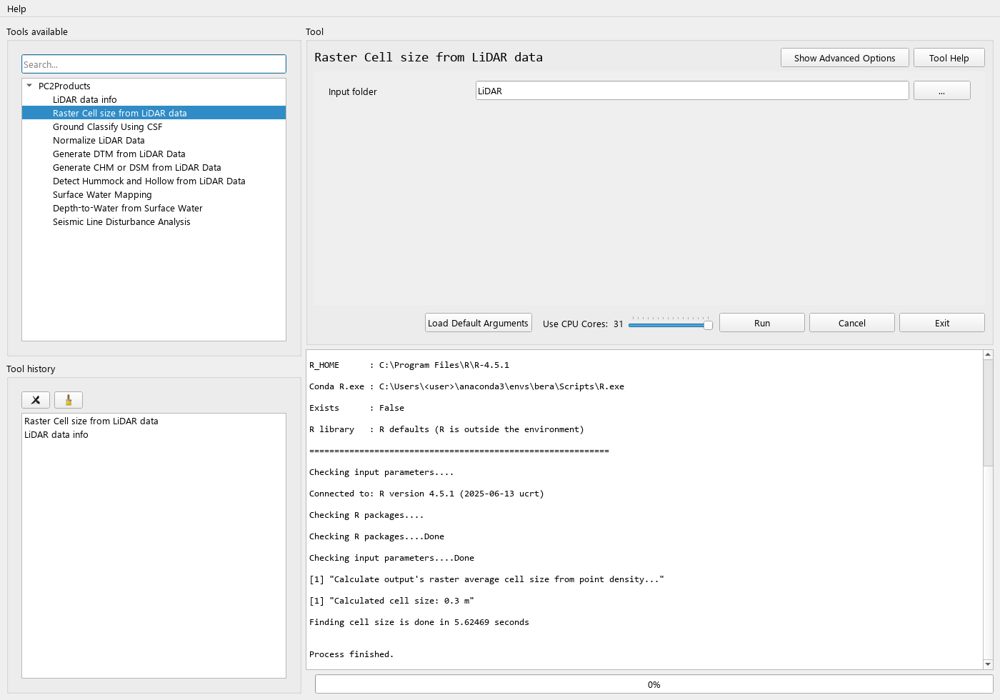

### Ground Classify Using CSF

Classifies ground points with the Cloth Simulation Filter (Zhang et al., 2016), using
`lidR::classify_ground` with `RCSF`'s `csf()` algorithm. The cloth runs for 500 iterations with a
time step of 0.65. Noise (class 7) and overlap points are dropped when the tiles are read.

If the input is already ground-classified (every tile has class 2 points), the existing
classification is replaced and lidR's progress messages are hidden.

| Parameter | Type | Required | Description |
|-----------|------|----------|-------------|
| `in_las_folder` | directory | Yes | Folder containing the input LAS/LAZ tiles. |
| `out_folder` | directory (output) | Yes | Folder for the classified point clouds. |
| `slope` | bool | No | Set to `True` when steep slopes exist, to reduce errors in post-processing. The default is `False`. |
| `class_threshold` | float | No | Distance to the simulated cloth that separates ground from non-ground points. The default is `0.5`. |
| `cloth_resolution` | float | No | Distance between cloth particles. This is usually the average point spacing. The default is `1.0`. |
| `rigidness` | `1` \| `2` \| `3` | No | Cloth stiffness: `1` is very soft (rugged terrain), `2` is medium, and `3` is hard (flat terrain). The default is `1`. |
| `processes` | int | No | Requested number of parallel workers. |

Output: one uncompressed `<tile>_gnd_classified.las` per input tile.

```python
from beratools.tools.rpy_gnd_csf import rpy_gnd_csf

rpy_gnd_csf(in_las_folder="tests/data/LiDAR",
            out_folder="tests/data/LiDAR/Classified_PC",
            slope=False, class_threshold=0.3, cloth_resolution=1.0, rigidness=1)
```

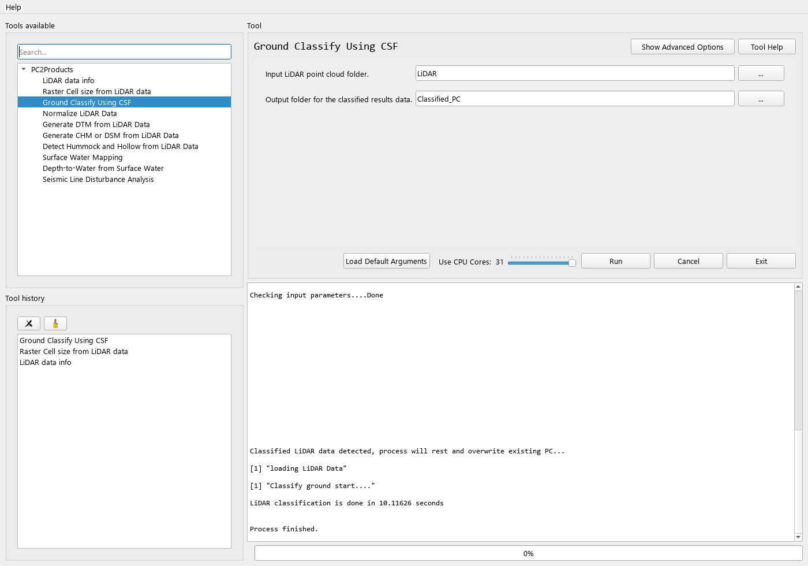

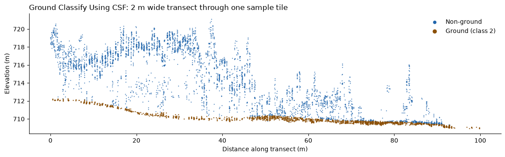

*A 2 m wide transect through `tile_554600_6138400_gnd_classified.las`, classified with the settings
above. The ground points (class 2) follow the terrain under the canopy.*

### Generate DTM from LiDAR Data

Builds a Digital Terrain Model from the ground points with `lidR::rasterize_terrain`. Every tile must
be ground-classified (see [How all the tools behave](#how-all-the-tools-behave)). The tool also reports
whether the data is height-normalized; if it is, the output is a normalized DTM.

| Parameter | Type | Required | Description |
|-----------|------|----------|-------------|
| `in_las_folder` | directory | Yes | Folder containing the ground-classified LAS/LAZ tiles. |
| `out_folder` | directory (output) | Yes | Folder for the output rasters. |
| `style` | `tin` \| `idw` \| `kriging` | Yes | Interpolation algorithm. The default is `tin`. An invalid value falls back to `tin`. |
| `cell_size` | float | No | Output cell size in metres. `0` (the default) calculates it from the point density. |
| `processes` | int | No | Requested number of parallel workers (see [How all the tools behave](#how-all-the-tools-behave)). |

| `style` | lidR algorithm | Tile output | Merged output |
|---------|----------------|-------------|---------------|
| `tin` | `tin()`: Delaunay triangulation | `<tile>_TIN_DTM.tif` | `Merged_TIN_DTM.tif` |
| `idw` | `knnidw()`: k-nearest-neighbour inverse distance weighting | `<tile>_IDW_DTM.tif` | `Merged_IDW_DTM.tif` |
| `kriging` | `kriging()`: local ordinary kriging with `gstat` | `<tile>_K_DTM.tif` | `Merged_K_DTM.tif` |

```python
from beratools.tools.rpy_dtm_by import rpy_dtm

rpy_dtm(in_las_folder="tests/data/LiDAR/Classified_PC",
        out_folder="tests/data/LiDAR/Raster_Output",
        style="tin", cell_size=0)
```

While a tool runs, the **Run** button is disabled and the R output streams into the log:

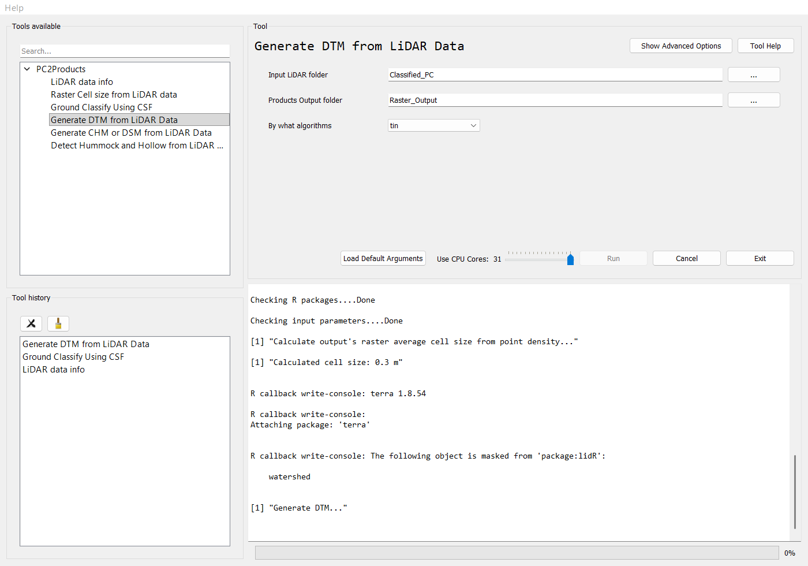

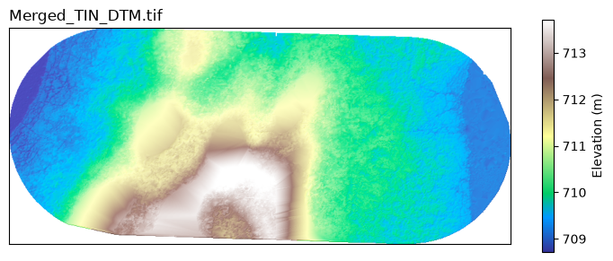

*`Merged_TIN_DTM.tif` from the ground-classified sample tiles, `style = tin`, `cell_size = 0.3`,
shown with a hillshade.*

### Normalize LiDAR Data

Height-normalizes the point cloud with `lidR::normalize_height`: the terrain is interpolated from the
ground points (class 2) and subtracted from every point, so Z becomes height above ground. Noise
(class 7) is dropped when the tiles are read. The data must be ground-classified, so run
[Ground Classify Using CSF](#ground-classify-using-csf) first if it isn't.

| Parameter | Type | Required | Description |
|-----------|------|----------|-------------|
| `in_las_folder` | directory | Yes | Folder containing the ground-classified LAS/LAZ tiles. |
| `out_folder` | directory (output) | Yes | Folder for the normalized point clouds. |
| `style` | `tin` \| `idw` \| `kriging` | Yes | Terrain interpolation algorithm: `tin()`, `knnidw()` or `kriging()`. The default is `tin`. An invalid value falls back to `tin`. |
| `processes` | int | No | Requested number of parallel workers. |

Output: one `<out_folder>/n_<tile>.las` per input tile. Write them to a folder of their own, such as
`Normalized_PC`, and point [Generate CHM or DSM from LiDAR Data](#generate-chm-or-dsm-from-lidar-data)
at that folder to get a CHM.

```python
from beratools.tools.rpy_normalized_PC import rpy_normalized_PC

rpy_normalized_PC(in_las_folder="tests/data/LiDAR/Classified_PC",
                  out_folder="tests/data/LiDAR/Normalized_PC",
                  style="tin")
```

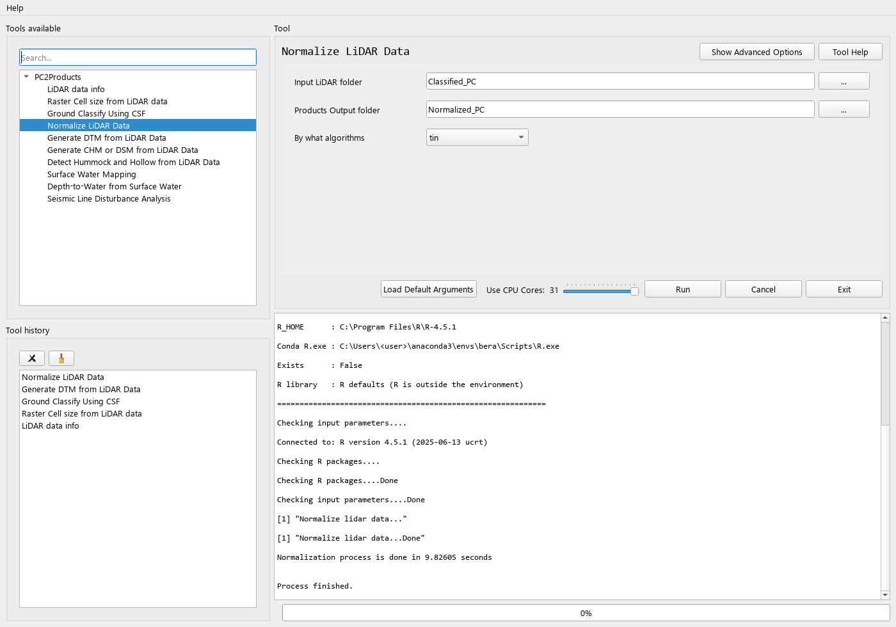

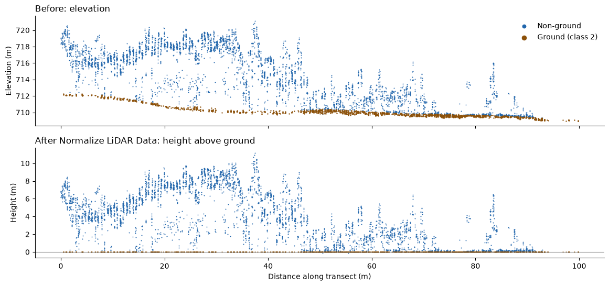

*The transect from [Ground Classify Using CSF](#ground-classify-using-csf), before and after
normalization with `style = tin`. The ground points lie on 0 m, and Z is height above ground.*

### Generate CHM or DSM from LiDAR Data

Builds a height surface from the point cloud with `lidR::rasterize_canopy`. The tool decides what to
produce by calling `detect_normalized`, which reads the **first** LAS/LAZ file in the folder, and prints which output it will produce:

- If the mean |Z| of the ground points (class 2) is **below 1**, the data counts as
  height-normalized and the tool produces a **CHM**.
- Otherwise, including when there are no ground points, the tool produces a **DSM**.

| Parameter | Type | Required | Description |
|-----------|------|----------|-------------|
| `in_las_folder` | directory | Yes | Folder containing the input LAS/LAZ tiles. |
| `out_folder` | directory (output) | Yes | Folder for the output rasters. |
| `style` | `tin` \| `pitfree` | Yes | Surface algorithm. The default is `tin`. An invalid value falls back to `tin`. |
| `cell_size` | float | No | Output cell size in metres. `0` (the default) calculates it from the point density. |
| `processes` | int | No | Requested number of parallel workers. |

| `style` | lidR algorithm | Tile output | Merged output |
|---------|----------------|-------------|---------------|
| `tin` | `dsmtin(max_edge = 3 × cell_size)` | `<tile>_TIN_CHM.tif` / `<tile>_TIN_DSM.tif` | `Merged_TIN_CHM.tif` / `Merged_TIN_DSM.tif` |
| `pitfree` | `pitfree(thresholds = c(0, 3, 5, 10, 15, 20), max_edge = c(0, 3 × cell_size), subcircle = cell_size)`. Overlap points are also dropped. | `<tile>_PitF_CHM.tif` / `<tile>_PitF_DSM.tif` | `Merged_PitF_CHM.tif` / `Merged_PitF_DSM.tif` |

```python
from beratools.tools.rpy_CHM_DSM_by import rpy_chm_dsm_by

# DSM from the original tiles
rpy_chm_dsm_by(in_las_folder="tests/data/LiDAR",
               out_folder="tests/data/LiDAR/Raster_Output",
               style="pitfree", cell_size=0)

# CHM from the output of Normalize LiDAR Data
rpy_chm_dsm_by(in_las_folder="tests/data/LiDAR/Normalized_PC",
               out_folder="tests/data/LiDAR/Raster_Output",
               style="tin", cell_size=0)
```

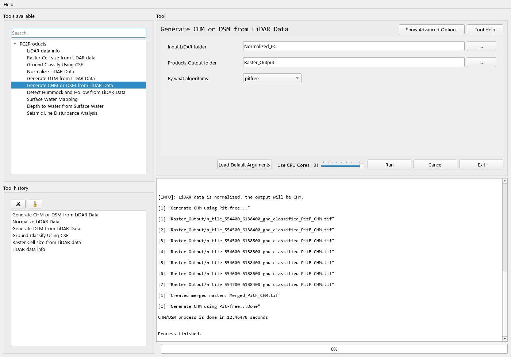

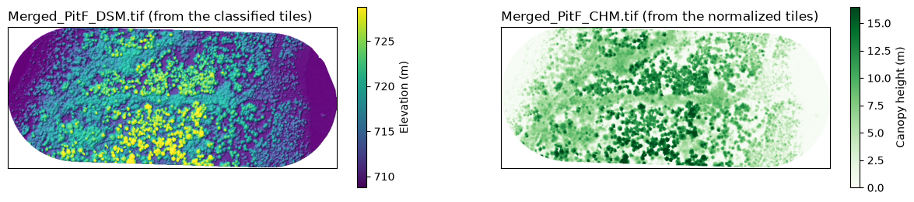

*Left: `Merged_PitF_DSM.tif` from the classified tiles (a DSM, because they aren't normalized),
shown with a hillshade. Right: `Merged_PitF_CHM.tif` from the normalized tiles. Both use
`style = pitfree` and `cell_size = 0.3`.*

### Detect Hummock and Hollow from LiDAR Data

Maps micro-topography by comparing the terrain with a smoothed copy of itself. For each tile, the
tool:

1. Builds a DTM with `rasterize_terrain(algorithm = tin())`.
2. Smooths it with a circular moving window of diameter `Min_ws`, using the `mean` or `median`
   (`terra::focal`).
3. Subtracts the DTM from the smoothed surface, and classifies each cell using `lawn_range`:

| Cell | Value in `HH_*.tif` |
|------|---------------------|
| More than `lawn_range` above the smoothed surface | `1` (hummock) |
| More than `lawn_range` below the smoothed surface | `-1` (hollow) |
| Within ±`lawn_range` | `0` (lawn) |

The data must be ground-classified. If any tile has no class 2 points, the tool prints a warning and
stops without writing anything. Run [Ground Classify Using CSF](#ground-classify-using-csf)
first.

| Parameter | Type | Required | Description |
|-----------|------|----------|-------------|
| `in_las_folder` | directory | Yes | Folder containing the ground-classified LAS/LAZ tiles. |
| `out_folder` | directory (output) | Yes | Folder for the output rasters. |
| `Smooth_by` | `mean` \| `median` | Yes | Statistic used to smooth the DTM. The default is `mean`. |
| `Min_ws` | float | Yes | Diameter of the circular moving window, in metres. The default is `3.0`. |
| `lawn_range` | float | Yes | Height band around the smoothed surface that counts as lawn, in metres. The default is `0.3`. |
| `cell_size` | float | No | Output cell size in metres. `0` (the default) calculates it from the point density. |
| `processes` | int | No | Requested number of parallel workers. |

| Output | Contents |
|--------|----------|
| `CHH_<tile>_<Smooth_by>_<Min_ws>m.tif` | Continuous height of the terrain relative to the smoothed surface. |
| `HH_<tile>_<Smooth_by>_<Min_ws>m.tif` | Hummock (`1`), hollow (`-1`) and lawn (`0`) classes. |
| `Merged_CHH_<Smooth_by>_<Min_ws>m.tif`, `Merged_HH_<Smooth_by>_<Min_ws>m.tif` | Mosaics of all tiles. |

```python
from beratools.tools.rpy_PC2hummock_hollow import rpy_hh2raster

rpy_hh2raster(in_las_folder="tests/data/LiDAR/Classified_PC",
              out_folder="tests/data/LiDAR/Raster_Output",
              Smooth_by="median", Min_ws=3.0, lawn_range=0.1, cell_size=0)
```

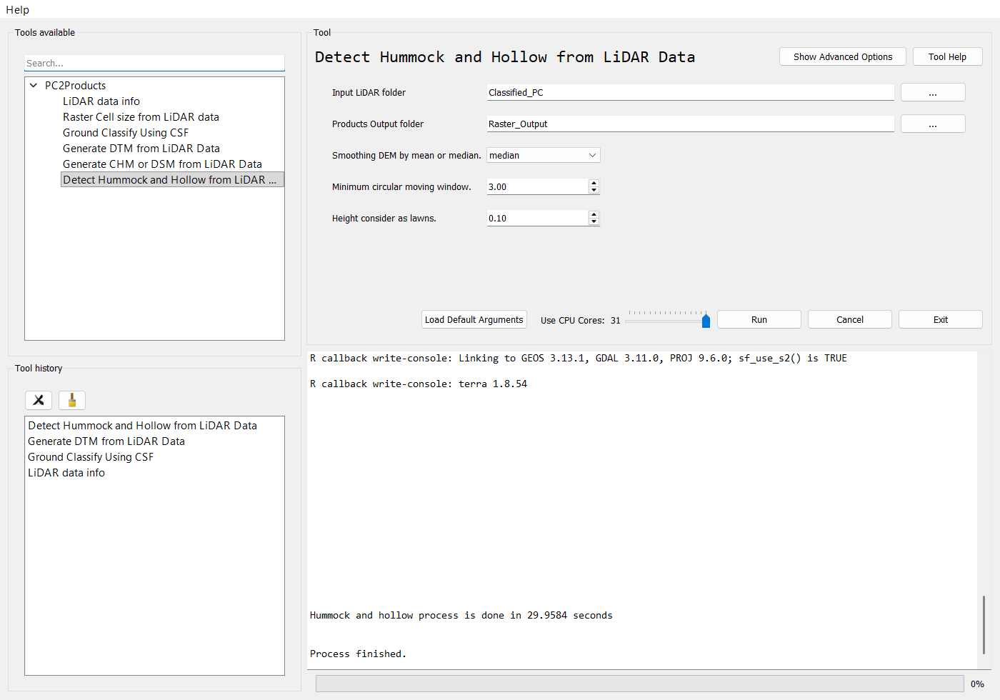

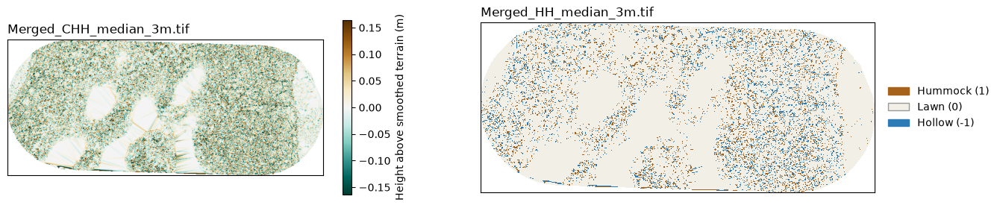

*`Merged_CHH_median_3m.tif` (left) and `Merged_HH_median_3m.tif` (right) from the classified sample
tiles, with `Smooth_by = median`, `Min_ws = 3`, `lawn_range = 0.1` and `cell_size = 0.3`.*

### Surface Water Mapping

Maps surface water from a true-colour orthomosaic, following section 2.4 of Chan, Dabros & McDermid
(2026):

1. Draws `points_per_polygon` random points inside each training polygon and reads the orthomosaic's
   red, green and blue values (bands 1–3) at each point.
2. Trains an `rpart` decision tree on those values, and estimates its accuracy with 5-fold
   cross-validation on the training points.
3. Classifies every cell of the orthomosaic. Cells the tree labels `water` become `1`, all others `0`.
   The tree only compares each band with its split values, so the tool turns it into a small lookup
   table and classifies cells with `findInterval`. This is much faster than `predict()` and gives the
   same result. The tool first checks the table against `predict()` on the training points and
   10,000 sample cells, and stops if they disagree.
4. If a CHM is given, sets cells with canopy taller than `max_canopy_height` to `0`. The CHM is
   projected and cropped to the orthomosaic once and turned into a canopy mask, which is resampled to
   each tile's grid. If the CHM doesn't overlap the orthomosaic, the tool warns and skips the mask.
5. Sets water patches (8-connected) smaller than `min_patch_area` to `0`.

Steps 3–5 run in parallel tiles of `tile_size` cells (see
[Tiled processing](#tiled-processing-for-surface-water-and-depth-to-water)). The tiles are then merged
into one compressed `surface_water.tif`.

The training polygons need a `class` field. Polygons labelled `water` (in any case) are surface water;
use any other labels for the rest, for example `ground` and `shadow` as in the paper. rpart needs at
least 20 training points before it splits, so the tool warns if the tree ends up with no splits.

| Parameter | Type | Required | Description |
|-----------|------|----------|-------------|
| `in_ortho` | raster | Yes | True-colour orthomosaic; bands 1–3 are red, green and blue. |
| `in_training` | vector (polygon) | Yes | Training polygons with a `class` field, as `file.gpkg\|layer` for a GeoPackage. |
| `out_folder` | directory (output) | Yes | Folder for the outputs. |
| `in_chm` | raster | No | Canopy height model, for example from [Generate CHM or DSM from LiDAR Data](#generate-chm-or-dsm-from-lidar-data). |
| `max_canopy_height` | float | No | Cells with a CHM above this height (m) can't be water. The default is `0.2`. |
| `min_patch_area` | float | No | Water patches smaller than this area (m²) are removed; `0` keeps them all. The default is `0.04` (20 × 20 cm). |
| `points_per_polygon` | int | No | Random training points per polygon. The default is `2`. |
| `seed` | int | No | Seed for the training points and cross-validation folds. The default is `1`. |
| `tile_size` | int | No | Tile size in cells per side. Smaller tiles use less memory per worker. The default is `2000`. |
| `processes` | int | No | Requested number of parallel workers. |

| Output | Contents |
|--------|----------|
| `surface_water.tif` | `1` for surface water, `0` for everything else. |
| `cv_accuracy.csv`, `cv_confusion_matrix.csv` | 5-fold cross-validation accuracy and confusion matrix. |
| `training_points.gpkg` | The random training points and their classes. |
| `decision_tree.txt` | The fitted tree's splits. |

```python
from beratools.tools.rpy_surface_water import rpy_surface_water

rpy_surface_water(in_ortho="ortho.tif", in_training="training.gpkg|training",
                  in_chm="chm.tif", out_folder="surface_water", tile_size=2000)
```

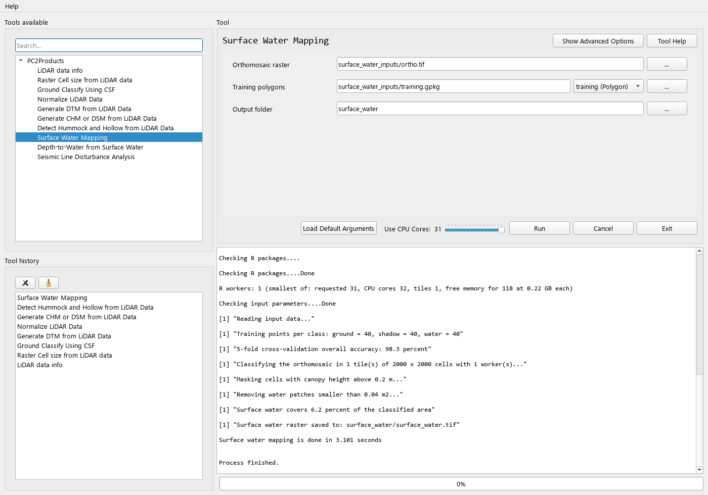

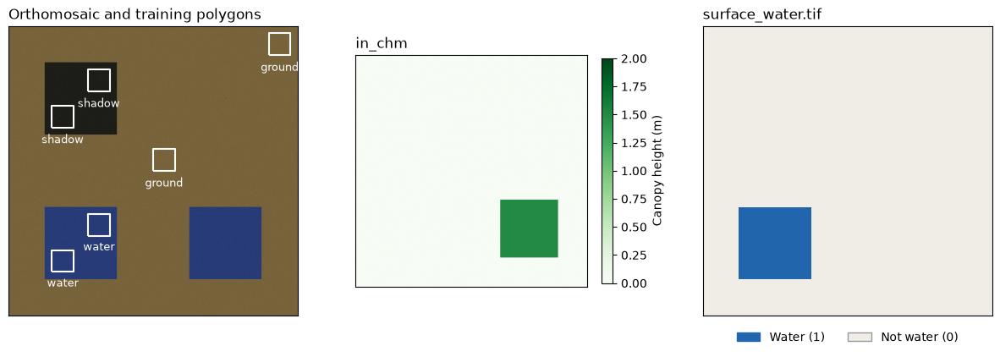

*The synthetic test scene from `make_surface_water_data` in `tests/conftest.py`, run with
`points_per_polygon = 20`. Both blue squares are water-coloured, but the right-hand one lies under
1.5 m of canopy, so the CHM mask removes it. A single water-coloured cell at the top right is also
removed, because it is smaller than `min_patch_area`.*

### Depth-to-Water from Surface Water

Estimates the water table and depth to water (DTW), following section 2.4 of Chan, Dabros & McDermid
(2026), which adapts Rahman et al. (2017). In peatlands, surface water is closely linked to the
groundwater, so the elevation of the many small pools traces the water table. The tool:

1. Puts the surface water raster on the DTM grid (by majority if the water raster is finer) and masks
   the DTM to the water cells.
2. Splits the area into `grid_size` cells (10 m in the paper). In each cell that contains water, the
   minimum water elevation becomes one point at the cell centre. Cells without water give no point.
3. Fits a variogram (`variogram_model`, Matern with M. Stein's parameterization by default, plus a
   nugget) and kriges the water table with ordinary kriging from the `nmax` nearest points (gstat).
4. Computes DTW = DTM − water table. Values below 0 and surface water cells are set to `0`.
5. Leaves out the exclusion polygons, if any: they give no water points and are NA in the outputs.
   The paper excluded an upland knoll this way, because it had too little surface water.

The kriging in step 3 runs in parallel tiles of `tile_size` cells of the kriging grid (see
[Tiled processing](#tiled-processing-for-surface-water-and-depth-to-water)). On the DTM grid, cells
without a DTM value or inside the exclusion polygons are skipped. The DTM must have a projected CRS,
because `grid_size` and `kriging_cell_size` are in metres; a longitude/latitude DTM stops the tool.

| Parameter | Type | Required | Description |
|-----------|------|----------|-------------|
| `in_dtm` | raster | Yes | DTM. The water table and DTW are produced on its grid. |
| `in_water` | raster | Yes | `1` for surface water, for example `surface_water.tif` from [Surface Water Mapping](#surface-water-mapping). |
| `out_folder` | directory (output) | Yes | Folder for the outputs. |
| `in_mask` | vector (polygon) | No | Areas to leave out, as `file.gpkg\|layer` for a GeoPackage. |
| `grid_size` | float | No | Grid cell size (m) for the water points. The default is `10`. |
| `nmax` | int | No | Nearest water points used for each prediction. The default is `10`. |
| `variogram_model` | `Ste` \| `Sph` \| `Exp` \| `Gau` | No | Variogram model. The default is `Ste` (Matern, as in the paper). |
| `kriging_cell_size` | float | No | Krige on a coarser grid (m), then resample bilinearly to the DTM. A value no larger than the DTM's cell size kriges on the DTM grid, which is slow for a large 10 cm DTM. The default is `0.01`, so any DTM coarser than 1 cm is kriged on its own grid. |
| `tile_size` | int | No | Tile size in cells of the kriging grid per side. Smaller tiles use less memory per worker. The default is `1000`. |
| `processes` | int | No | Requested number of parallel workers. |

| Output | Contents |
|--------|----------|
| `water_table.tif` | Kriged water table elevation (compressed 32-bit float). |
| `dtw.tif` | Depth to water (m): positive below ground, `0` on surface water (compressed 32-bit float). |
| `water_points.gpkg` | The water elevation points used for kriging. |
| `variogram_model.csv`, `variogram.png` | Fitted variogram parameters and plot. |
| `water_table_cv.csv` | Leave-one-out cross-validation of the water table at the water points (MAE, RMSE). |

On the paper's data, with the surface water taken from the published `dtw.tif` (cells equal to `0`)
and `kriging_cell_size = 1`, the tool's DTW correlates with the published DTW at r = 0.97, and its
leave-one-out MAE is 3.9 cm. It is about 4 cm deeper on average, probably because cells the paper set
to `0` for lying below the water table were treated as water in that test.

```python
from beratools.tools.rpy_dtw import rpy_dtw

rpy_dtw(in_dtm="dtm.tif", in_water="surface_water/surface_water.tif",
        in_mask="exclude.gpkg|exclude", out_folder="dtw", kriging_cell_size=1.0, tile_size=1000)
```

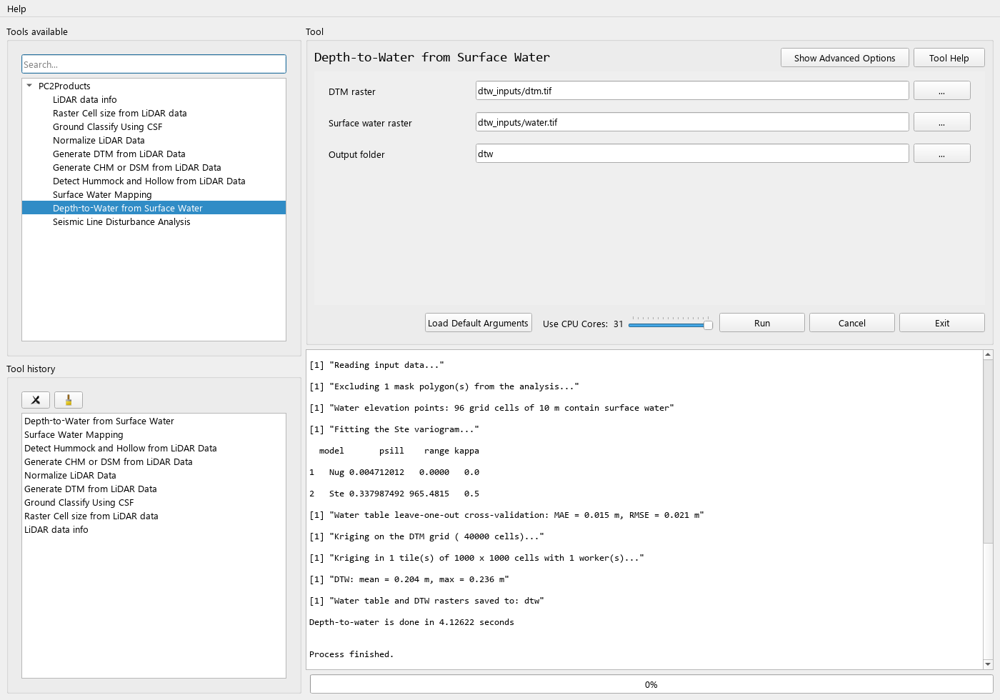

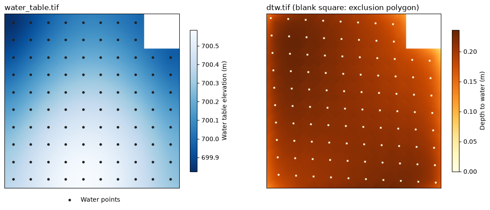

*The synthetic test DTM and pools from `make_dtw_data` in `tests/conftest.py`, kriged on the DTM
grid. Each black dot is one 10 m cell's water point. DTW is `0` on the pools and blank inside the
exclusion polygon.*

### Seismic Line Disturbance Analysis

Compares seismic line segments with the undisturbed peatland ("matrix") beside them, by disturbance
class. It is adapted from the analysis script of Chan, Dabros & McDermid (2026),
[*Microtopographic and Hydrological Response to Repeated Seismic Line Disturbance in a Boreal Fen of
Northern Alberta, Canada*](https://doi.org/10.3390/f17040489), *Forests* 17, 489. On the paper's
published data it gives the same tables as the original script. It needs only the `terra` and
`ggplot2` R packages; the statistical tests are written in base R.

For each segment, the tool summarises the rasters under it. Then, for each line segment, it subtracts
the mean of its matrix segments:

| Attribute | From | Per segment | Deviation |
|-----------|------|-------------|-----------|
| `dtm` | DTM | Mean elevation | Line − matrix (m) |
| `hummock` | Microform raster | Hummock cells / classified cells | Line − matrix |
| `dtw` | Depth-to-water raster | Mean DTW over ground cells (DTW ≠ 0) | Line − matrix (m) |
| `surfacewater` | Depth-to-water raster | Cells with DTW = 0 / all cells | Line − matrix |

For each attribute it compares the disturbance classes with:

- a Kruskal–Wallis test, and pairwise Wilcoxon rank-sum tests with Benjamini–Hochberg (BH) correction.
  The `mean_group` letters come from these.
- a Brown–Forsythe test, and pairwise Brown–Forsythe tests with BH correction. The `bf_group` letters
  come from these. This is the Brown–Forsythe test for equal *means* under unequal variances (the
  statistic of `onewaytests::bf.test`, which the original script uses).

Classes that share a letter don't differ significantly at the chosen `significance`.

| Parameter | Type | Required | Description |
|-----------|------|----------|-------------|
| `in_segments` | vector (polygon) | Yes | Segment polygons, as `file.gpkg\|layer` for a GeoPackage. Fields: `new_id` links a line segment to its matrix segments, `note` is `original` (line) or `matrix`, and `Class` is the disturbance class. |
| `in_dtm` | raster | Yes | DTM, for example from [Generate DTM from LiDAR Data](#generate-dtm-from-lidar-data). |
| `in_microform` | raster | Yes | Hummock (`1`), lawn (`0`) and hollow (`-1`) raster, for example the `HH_` or `Merged_HH_` output of [Detect Hummock and Hollow from LiDAR Data](#detect-hummock-and-hollow-from-lidar-data). |
| `out_folder` | directory (output) | Yes | Folder for the `tables/` and `plots/` outputs. |
| `in_dtw` | raster | No | Depth to water in metres, with `0` for surface water. Without it, `dtw` and `surfacewater` are skipped. |
| `significance` | float | No | Significance level for the letter groupings. The default is `0.05`. |

The segments are projected to the DTM's coordinate system if they differ. Classes named `New
Disturbance`, `Old Disturbance` and `Re-disturbance` keep the paper's order and colours; any other
class names are sorted alphabetically.

| Output | Contents |
|--------|----------|
| `tables/segment_values.csv` | Per-segment summaries for every segment. |
| `tables/segment_deviations.csv` | Per-line-segment deviations from the matrix. |
| `tables/<attribute>_deviation_summary.csv` | By class: n, mean, median, min, max, quartiles, SD, variance, `mean_group` and `bf_group`. |
| `tables/<attribute>_kruskal_wilcoxon.csv` | Kruskal–Wallis result and BH-adjusted pairwise Wilcoxon p-values. |
| `tables/<attribute>_brown_forsythe.csv` | Brown–Forsythe result and pairwise p-values (raw and BH-adjusted). |
| `tables/class_microform_proportions.csv`, `tables/class_surfacewater_proportions.csv` | Cell proportions for the matrix and each class. |
| `plots/<attribute>_violin.png` | Deviation distribution per class, with the class mean (dot) and `mean_group` letters. |
| `plots/microform_barplot.png`, `plots/surfacewater_barplot.png` | Stacked proportions for the matrix and each class. |

```python
from beratools.tools.rpy_seismic_line_analysis import rpy_seismic_line_analysis

rpy_seismic_line_analysis(in_segments="segments.gpkg|segments",
                          in_dtm="dtm.tif", in_microform="microform.tif", in_dtw="dtw.tif",
                          out_folder="analysis")
```

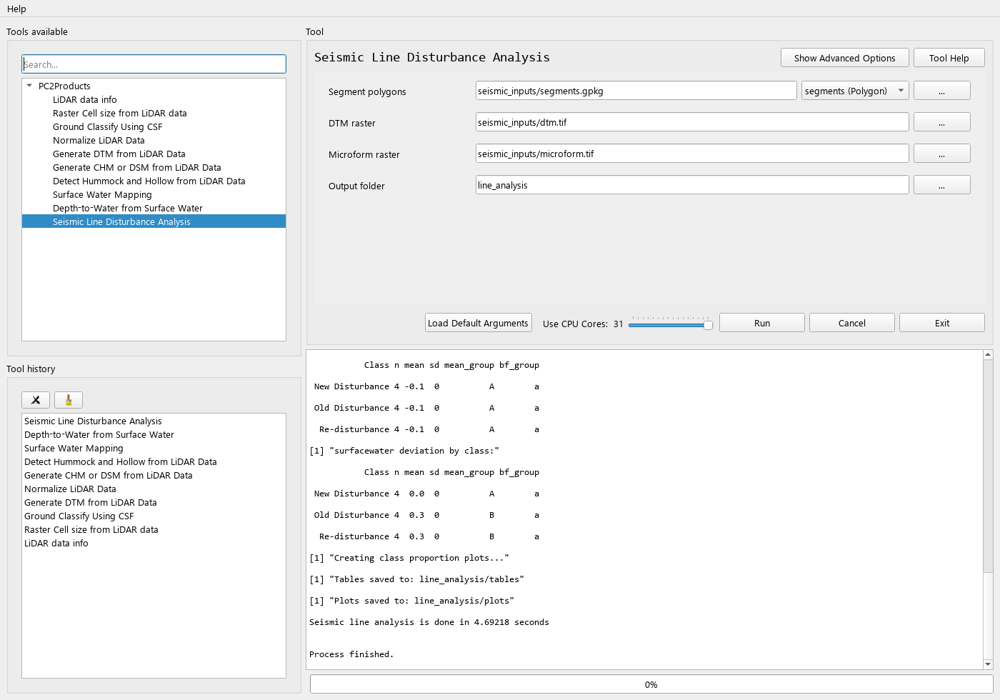

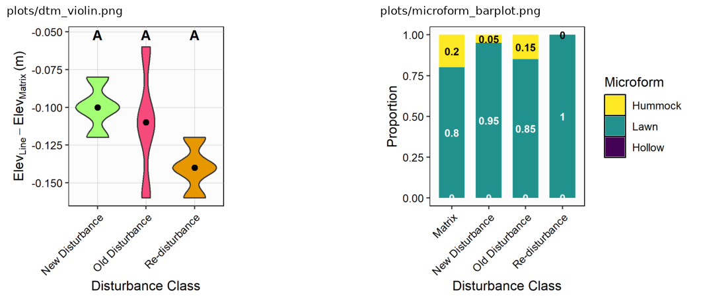

*Two of the plots the tool writes to `plots/`, from the synthetic segments and rasters made by
`make_seismic_line_data` in `tests/conftest.py`.*

#### Reproducing Chan et al. (2026)

The paper's workflow maps onto the PC2Products tools like this:

| Paper step | PC2Products tool | Settings |
|------------|------------------|----------|
| Ground classification (LAStools in the paper) | Ground Classify Using CSF | Defaults |
| 10 cm DTM with `knnidw` (k = 10, p = 2) | Generate DTM from LiDAR Data | `style = idw` (lidR's `knnidw()` defaults are k = 10, p = 2). The cell size comes from the point density and can't be set. |
| Microforms: DTM minus its 3 m focal mean, ±6 cm | Detect Hummock and Hollow from LiDAR Data | `Smooth_by = mean`, `Min_ws = 3`, `lawn_range = 0.06`, `cell_size = 0.1`. The tool builds its own DTM with TIN. |
| Surface water: rpart classification of the orthomosaic's RGB values, CHM mask (> 0.2 m), patches under 20 × 20 cm removed | Surface Water Mapping | Defaults, with the CHM as `in_chm` |
| Water table: minimum water elevation per 10 m cell, ordinary kriging (Matern, 10 nearest), then DTW = DTM − water table | Depth-to-Water from Surface Water | Defaults, with the upland knoll as `in_mask` |
| Segments along mapped centrelines (Forest Line Mapper) | None | Not available; supply `in_segments` from elsewhere. |
| Comparison and statistics | Seismic Line Disturbance Analysis | `significance = 0.05` |

The paper's published data (`dtm.tif`, `dtw.tif`, `microform.tif` and `segments.gpkg`, on
[Zenodo](https://doi.org/10.5281/zenodo.18778508)) can be used directly as the inputs to Seismic Line
Disturbance Analysis.

---

### Running from the command line

#### The `bt` command

Installing the package (see [Installation](#installation)) adds a `bt` command (also available as `PC2Products`)
with one subcommand per tool:

| Subcommand | Tool |
|------------|------|
| `bt las_info` | LiDAR data info |
| `bt cellsize` | Raster Cell size from LiDAR data |
| `bt gnd_csf` | Ground Classify Using CSF |
| `bt dtm` | Generate DTM from LiDAR Data |
| `bt normalize` | Normalize LiDAR Data |
| `bt chm_dsm` | Generate CHM or DSM from LiDAR Data |
| `bt hh` | Detect Hummock and Hollow from LiDAR Data |
| `bt surface_water` | Surface Water Mapping |
| `bt dtw` | Depth-to-Water from Surface Water |
| `bt line_analysis` | Seismic Line Disturbance Analysis |

```bash
bt list-tools                       # list the tool subcommands
bt las_info                         # show the parameters for one tool
bt las_info --in_las_folder <las_dir>
bt cellsize --in_las_folder <las_dir>
bt gnd_csf  --in_las_folder <las_dir> --out_folder <out_dir> --slope false --rigidness 2
bt dtm      --in_las_folder <las_dir> --out_folder <out_dir> --style tin --cell_size 0 -p 4
bt normalize --in_las_folder <las_dir> --out_folder <out_dir> --style tin
bt chm_dsm  --in_las_folder <las_dir> --out_folder <out_dir> --style pitfree --cell_size 0.5
bt hh       --in_las_folder <las_dir> --out_folder <out_dir> --Smooth_by median --Min_ws 3 --lawn_range 0.1
bt surface_water --in_ortho ortho.tif --in_training "training.gpkg|training" --in_chm chm.tif --out_folder <out_dir> --tile_size 2000
bt dtw --in_dtm dtm.tif --in_water surface_water.tif --out_folder <out_dir> --kriging_cell_size 1 --tile_size 1000
bt line_analysis --in_segments "segments.gpkg|segments" --in_dtm dtm.tif --in_microform HH.tif --in_dtw dtw.tif --out_folder <out_dir>
bt gui                              # launch the GUI
```

`bt` reads each tool's parameters from `beratools.json`. It converts values to the right type
(`--Min_ws 3` becomes `3.0`, `--slope false` becomes `False`, `--rigidness 2` becomes `2`) and
rejects anything that isn't one of a list parameter's allowed values.

#### Running a module directly

Each module can also be run as a script:

```bash
python -m beratools.tools.rpy_las_info          --in_las_folder <las_dir>
python -m beratools.tools.rpy_find_cellsize     --in_las_folder <las_dir>
python -m beratools.tools.rpy_gnd_csf           --in_las_folder <las_dir> --out_folder <out_dir>
python -m beratools.tools.rpy_dtm_by            --in_las_folder <las_dir> --out_folder <out_dir> --style tin -p 4
python -m beratools.tools.rpy_normalized_PC     --in_las_folder <las_dir> --out_folder <out_dir> --style tin
python -m beratools.tools.rpy_CHM_DSM_by        --in_las_folder <las_dir> --out_folder <out_dir> --style pitfree
python -m beratools.tools.rpy_PC2hummock_hollow --in_las_folder <las_dir> --out_folder <out_dir> --Smooth_by mean
python -m beratools.tools.rpy_surface_water --in_ortho ortho.tif --in_training "training.gpkg|training" --out_folder <out_dir>
python -m beratools.tools.rpy_dtw --in_dtm dtm.tif --in_water surface_water.tif --out_folder <out_dir>
python -m beratools.tools.rpy_seismic_line_analysis --in_segments "segments.gpkg|segments" --in_dtm dtm.tif --in_microform HH.tif --out_folder <out_dir>
```

`-p/--processes` sets the requested number of workers, and `-l/--log_level` sets the log level.

#### How the GUI runs a tool

The GUI starts the tool module in a new process and passes the parameters as JSON with `-i/--input`.
The module checks them against `beratools.json` in `BTData.validate_tool_params`: it confirms that
input folders exist, checks list values against the allowed options, and converts numbers and
booleans to the right type. Output parameters aren't checked, because they don't exist yet.

Each module's `compose_tool_kwargs("<tool_api>")` call must use the tool's `tool_api` from
`beratools.json`, or the tool stops with `Tool API '<name>' not found in beratools.json`.

### Example workflow

`examples/full_workflow.py` runs the whole [typical workflow](#typical-workflow) in one go, driven by
[Hydra](https://hydra.cc/) and `examples/config.yaml`. It runs LiDAR info and cell size on the input
tiles, classifies ground with CSF, and then builds the DTM, CHM/DSM and hummock/hollow rasters from the
classified tiles. The defaults use the sample tiles in `tests/data/LiDAR/`.

```bash
python examples/full_workflow.py           # run every step on the sample tiles
python examples/full_workflow.py processes=4 DATA_DIR=D:/my_data/LiDAR
python examples/full_workflow.py steps_to_run=[dtm,chm_dsm] args_chm_dsm.style=pitfree
```

Run it from the repository root, because the default paths are relative to it. See
[examples/README.md](examples/README.md) for the folder settings, all the steps and the outputs.

#### DTM, DSM and CHM pipeline

`examples/pc2products_pipeline.py` turns a folder of tiles into DTM, DSM and CHM rasters, and checks the
data first so it only runs the steps it needs:

1. **Ground classified?** If any tile has no ground points (class 2), it runs
   [Ground Classify Using CSF](#ground-classify-using-csf) into `OUT_FOLDER/Classified_PC/`; otherwise it
   uses the input tiles as they are.
2. **DTM**: [Generate DTM from LiDAR Data](#generate-dtm-from-lidar-data) from the ground-classified
   tiles.
3. **Normalized?** If not, it builds a DSM from the ground-classified tiles,
   [normalizes](#normalize-lidar-data) them into `OUT_FOLDER/Normalized_PC/`, and builds the CHM from the
   normalized tiles. If the data is already normalized, no DSM can be made, so it builds the CHM straight
   away (and warns that the DTM will be flat, at about 0 m).

```bash
python examples/pc2products_pipeline.py tests/data/LiDAR D:/my_output
python examples/pc2products_pipeline.py D:/my_data/LiDAR D:/my_output --processes 4 --style kriging
```

| Option | Default | Meaning |
|--------|---------|---------|
| `--processes` | `0` | Worker processes (`0` = all CPU cores). |
| `--style` | `tin` | Interpolation. `tin`, `idw` and `kriging` apply to the DTM and normalization, `tin` and `pitfree` to the DSM and CHM; a style that doesn't apply to a step falls back to `tin` for it. |
| `--cell-size` | `0.0` | Raster cell size (`0` = estimate from the data). |
| `--slope`, `--class-threshold`, `--cloth-resolution`, `--rigidness` | off, `0.3`, `1.0`, `1` | CSF settings, used only when the data needs classifying. |

The rasters (`Merged_*_DTM.tif`, `Merged_*_DSM.tif` and `Merged_*_CHM.tif`, plus the per-tile rasters)
are written to `OUT_FOLDER/Raster_Output/`. The pipeline needs no extra packages, and `run_pipeline()`
can also be imported and called from Python with the same arguments.

#### Building your own pipeline in the GUI

The **Pipeline** tab (next to **Tool history**) lets you chain tools without writing code:

1. Drag tools from **Tools available** into the Pipeline tab (dragging over the tab switches to it), or
   select a tool and click the add button. Drag steps, or use the arrow buttons, to reorder them.
2. Click a step to edit its parameters in the tool form; the changes are kept in the step.
3. **Inputs from earlier steps** links a step's inputs to earlier steps' outputs, with one choice per
   input. A LiDAR folder can come from **Ground Classify Using CSF** or **Normalize LiDAR Data**, and a
   raster such as `in_dtm` or `in_microform` from the step that makes it; at run time it reads that
   step's `Merged_*` mosaic (or its single-tile raster). Choose **Its own value** to use the path in
   the form instead.

   Each input links to the latest earlier step that makes what it needs, which is not always the step
   just before it. In `CSF → DTM → CHM`, the CHM reads the CSF tiles, because the DTM step writes
   rasters, not point clouds; in `CSF → Normalize → CHM`, it reads the normalized tiles. The links are
   reset this way whenever a step is added, moved or removed, replacing any you chose by hand. Which
   inputs and outputs match is set by `accepts` and `produces` in `beratools.json` (see
   [Add a new tool](docs/files/developer/add_new_tool.md)), so new tools join in without code changes.
4. Click **Run Pipeline**. The steps run one after another with the CPU cores set by the slider, and
   the pipeline stops if a step fails or you click **Cancel**.

Save and load pipelines as `.json` files with the buttons above the list. A saved pipeline can also run
without the GUI:

```bash
python -m beratools.core.pipeline my_pipeline.json --processes 4
```

---

### Requirements

**Python:** `rpy2` and `psutil`, in addition to the core BERA Tools dependencies (Surface Water
Mapping and Depth-to-Water also use `rasterio`, one of those, to plan their tiles). The
[example workflow](#example-workflow) also needs `hydra-core`. All three are in `environment.yml` and
`pixi.toml`.

**R:** `r-base` 4.5.x. The tools install the following packages into it the first time they need
them (see [How all the tools behave](#how-all-the-tools-behave)):

| R package | Purpose |
|-----------|---------|
| `lidR` | LAScatalog processing, `rasterize_terrain`, `rasterize_canopy` |
| `rlas` | Reading LAS/LAZ files |
| `future` | Parallel processing of catalogs |
| `terra` | Raster output and mosaicking |
| `sf`, `units` | CRS, area and map-unit reporting |
| `RCSF` | Cloth Simulation Filter for ground classification |
| `gstat` | Kriging interpolation (DTM and water table) |
| `sp`, `raster`, `stars` | Spatial and raster support |
| `ggplot2` | Plots from Seismic Line Disturbance Analysis |
| `rpart` | Decision tree in Surface Water Mapping |

#### How R is located

`r_interface.py` looks for R **before** it imports rpy2, and checks these places in order:

1. An existing `R_HOME` environment variable
2. `Rscript` or `R` on the `PATH` (`R_HOME` is set from the output of `<exe> RHOME`)
3. R installed in the conda or pixi environment: `Lib/R` (Windows) or `lib/R` (Linux), next to the
   Python executable or under `sys.prefix`
4. A standard Windows install under `C:\Program Files\R\R-*`

It then adds the environment's `Library\bin`, `Library\mingw-w64\bin`, `Library\usr\bin`, `Scripts`
and `R_HOME\bin` folders to the DLL search path and `PATH`. If it can't find R, it prints
`sys.executable`, `sys.prefix`, `R_HOME` and the `which R` / `which Rscript` results to help with
debugging, then raises an error with installation instructions.

It also sets `RPY2_CFFI_MODE=ABI`, so rpy2 connects to R in ABI mode instead of API mode, which avoids
an error when importing rpy2 in API mode.

### Installation

Both environments contain only R and rpy2 on the R side. Every R package comes from CRAN, installed by
the tools into the environment's R the first time they need it (see
[How all the tools behave](#how-all-the-tools-behave)).

| | `environment.yml` (conda) | `pixi.toml` (pixi) |
|---|---|---|
| Python | 3.12 or newer | 3.14 |
| R | `r-base` 4.5.x | `r-base` 4.5.x |
| rpy2 | From PyPI | From conda-forge on Linux, from PyPI on Windows |
| R packages | None | None |
| Platforms | Any | `win-64`, `linux-64` |

R is held at 4.5.x because conda-forge builds rpy2 for R 4.5 on Linux only, and for nothing newer
than R 4.4 on Windows, which is why rpy2 comes from PyPI on Windows. On Windows, CRAN provides
prebuilt packages for R 4.5. On Linux, CRAN packages such as `sf` and `terra` are compiled from
source, which needs the GDAL, GEOS, PROJ and udunits development libraries (for example
`libgdal-dev libgeos-dev libproj-dev libudunits2-dev` on Ubuntu) and takes a while on the first run.

**Conda**

```bash
conda env create -n PC2Products -f environment.yml
conda activate PC2Products
pip install --no-deps -e .
```

**Pixi**

```bash
pixi install    # also installs beratools in editable mode, plus pytest and the docs tools
pixi run main   # launch the BERA Tools GUI
```

To install every R package up front and confirm that they load, run the R environment test:

```bash
python -m pytest tests/test_r_environment.py -v
```

> **Windows note:** run the tools from an *activated* environment. If you call the environment's
> `python.exe` directly without activating it, GDAL can fail to load its DLLs.

> **Windows note (rpy2 with a standard R install):** if you use R from `C:\Program Files\R` with rpy2
> installed by pip, run the tools and the R tests from **PowerShell or cmd, not Git Bash**. Under
> Git Bash, rpy2 3.6 crashes while locating R (`IndexError` in `rpy2/situation`), because Git Bash's
> `sh` makes `R CMD config` return empty output instead of failing.

### Testing

Sample tiles are in `tests/data/LiDAR/`. The tools write rasters to `tests/data/LiDAR/Raster_Output/`
and point clouds to `tests/data/LiDAR/Classified_PC/` and `tests/data/LiDAR/Normalized_PC/`; all three
are git-ignored. The tests use the arguments in `tests/conftest.py` (the `tool_r_arguments_integration`
and `tool_arguments_r_workflow` fixtures).

| Tests | What they cover | Needs R |
|-------|-----------------|---------|
| `tests/test_tools.py` | Runs each LiDAR tool on the sample tiles and checks the output (the `Merged_*` mosaics for the raster tools) | Yes |
| `tests/test_workflow.py` | Runs CSF classification, DTM, DSM, normalization, CHM (from the normalized tiles) and hummock/hollow in sequence on the sample tiles, checking each tool's output, then deletes the outputs | Yes |
| `tests/test_r_environment.py` | Installs any missing R packages the tools need, then checks that they load | Yes |
| `tests/test_surface_water.py` | Runs Surface Water Mapping on a synthetic orthomosaic, CHM and training polygons (built by `make_surface_water_data` in `tests/conftest.py`) and checks the water, canopy mask and patch filter | Yes |
| `tests/test_dtw.py` | Runs Depth-to-Water from Surface Water on a synthetic DTM with a known water table (built by `make_dtw_data` in `tests/conftest.py`) and checks the water table, DTW and exclusion mask | Yes |
| `tests/test_seismic_line_analysis.py` | Runs Seismic Line Disturbance Analysis on synthetic rasters and segments (built by `make_seismic_line_data` in `tests/conftest.py`) and checks the class means | Yes |
| `tests/test_cli_entry.py` | `bt` subcommands, argument conversion and rejection of invalid values | No |
| `tests/test_bt_data_validation.py` | Input validation in `BTData` | No |
| `tests/test_bt_data_version.py` | How the app version is resolved from package metadata and git | No |
| `tests/test_pixi_manifest.py` | `pixi.toml` installs `pc2products` (editable) and the docs dependencies | No |
| `tests/pytest_qt/` | GUI forms for each tool, and GUI-to-validation round trips (see its [README](tests/pytest_qt/README.md)) | No |
| `tests/pywinauto/` | Desktop GUI automation (Windows, needs `pywinauto`) | No |

```bash
# Everything except the pywinauto GUI automation
python -m pytest tests --ignore=tests/pywinauto

# Only the R tool tests
python -m pytest tests/test_tools.py tests/test_r_environment.py -v

# Only the fast tests (no R needed)
python -m pytest tests/test_cli_entry.py tests/pytest_qt -v
```

#### Continuous integration

`.github/workflows/python-integration-tests.yml` runs on pushes and pull requests to `main` that
change `beratools/`, `tests/`, `pixi.toml`, `pixi.lock`, `pyproject.toml` or the workflow itself. On
Ubuntu it sets up the pixi environment and installs the system GDAL/GEOS/PROJ/udunits libraries.
It then runs `tests/test_r_environment.py`, which compiles and installs the R packages into the pixi
R, and `tests/test_workflow.py`, both with coverage. The job's timeout is 60 minutes to leave room
for compiling the R packages.

`.github/workflows/python-compatibility-tests.yml` is started by hand (`workflow_dispatch`). It runs
the tests with tox on Python 3.12, 3.13 and 3.14 in a conda-forge environment that includes R 4.5,
rpy2 and the R packages. Python 3.14 runs without `networkit`, because conda-forge has no build of it
for 3.14.
