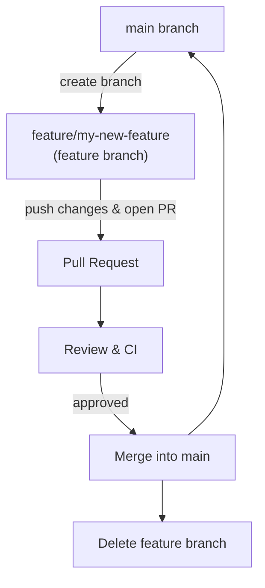

# Local Development

These are guidelines for developers of PC2Products. It covers local development setup, GitHub flow, branch naming conventions, and best practices for managing branches and merge conflicts.

## Things to Know before Starting

- Use short-lived branches to minimize merge conflicts.
- Regularly sync your branches with the main branch to stay up to date.
- Write descriptive commit messages to make it easier to understand changes.
- Test your code thoroughly to ensure quality and functionality.

## Clone the repository

```bash
git clone https://github.com/appliedgrg/pc2products.git
cd pc2products
```

## Branching or Forking

Branches are always recommended for development. It can be done in two ways:

- Create branches directly in the main repository if you have write access
- Fork the repository to your own GitHub account and create branches there

Branches should be made from main branch.

## Local Development Setup

PC2Products needs Python, R 4.5.x and rpy2. Both environments below provide them; the R packages are
installed from CRAN by the tools the first time they run (see
[Installation](../user/installation.md)).

### Using Conda Environment

Create the environment from [`environment.yml`](https://github.com/appliedgrg/pc2products/blob/main/environment.yml),
then install the local code in editable mode:

```bash
conda env create -n PC2Products -f environment.yml
conda activate PC2Products
pip install --no-deps -e .
bt list-tools   # This should list the PC2Products tools
bt gui          # This should start the main GUI
```

The editable mode (`-e`) allows you to make changes to the source code and have them reflected immediately without needing to reinstall the package.

### Using Pixi

Pixi sets up the same environment from [`pixi.toml`](https://github.com/appliedgrg/pc2products/blob/main/pixi.toml),
and also installs the project (`pc2products`, which provides the `beratools` package) in editable mode, pytest and the docs tools.

1. **Install pixi**

    Follow the official instructions at [pixi.sh](https://pixi.sh/docs/install/) to install pixi.

1. **Create the environment**

    In the project root, run:

    ```bash
    pixi install
    ```

1. **Activate the environment, or run a task**

    ```bash
    pixi shell      # activate the environment
    pixi run main   # launch the BERA Tools GUI
    ```

1. **Update the environment**

    To update dependencies, re-run `pixi install`. Pixi will detect changes in `pixi.toml` and install or update packages accordingly.

### Install the R packages

To install every R package the tools need and check that they load, run:

```bash
python -m pytest tests/test_r_environment.py -v
```

On Linux, CRAN packages such as `sf` and `terra` are compiled from source, which needs the GDAL, GEOS,
PROJ and udunits development libraries (for example `libgdal-dev libgeos-dev libproj-dev libudunits2-dev`
on Ubuntu).

## Testing your changes

After making changes to the code, run the test suite (see [Code Testing](testing.md)):

```bash
python -m pytest tests --ignore=tests/pywinauto
```

## Pull Requests and Code Reviews

When your changes are ready, push your branch to the remote repository and open a pull request (PR) on GitHub. Request reviews from team members to ensure code quality and adherence to project standards.

Now that you have a basic understanding of local development setup and workflow, let's explore some advanced topics.

## Advanced Topics

### Branch Naming Conventions

- Use descriptive names for branches, prefixed by the type of work being done:
    - `feature/` for new features
    - `bugfix/` for bug fixes
    - `doc/` for documentation changes
    - `refactor/` for code refactoring
- Use hyphens to separate words (e.g., `feature/add-water-table-tool`).
- Keep branch names concise yet descriptive.
- Avoid using special characters or spaces in branch names.
- Example branch names:
    - `feature/add-normalize-tool`
    - `bugfix/fix-kriging-workers`
    - `doc/update-readme`
    - `refactor/share-r-helpers`

### Long-lived Branches

**Short-lived branches** are typically used for specific features or bug fixes. They are created from the main branch, worked on, and then merged back into the main branch as quickly as possible (usually within a few days or weeks). This approach helps to keep the main branch clean and reduces the risk of merge conflicts.

**Long-lived branches**, on the other hand, are used for larger features or ongoing work that may take longer (weeks, even months) to complete. While they allow for more extensive changes, they have drawbacks such as:

- Higher risks of merge conflicts
- More effort to integrate back into the main branch.

Best practices when using long-lived branches:

- Regularly pull changes from the main branch to minimize conflicts.
- Consider breaking down large features into smaller tasks that can be completed in short-lived branches and then merged into the long-lived branch.
- Communicate with your team about the status of long-lived branches to ensure everyone is aware of ongoing work and potential integration challenges.

### GitHub Flow

We use a [GitHub Flow](https://docs.github.com/en/get-started/quickstart/github-flow) for development. All changes are made through feature branches and pull requests.



1. Create a new branch for your feature or bugfix:

   ```bash
   git checkout -b feature/my-new-feature
   ```

1. Make your changes and commit them with descriptive messages:

   ```bash
   git add .
   git commit -m "Add new feature X"
   ```

1. Push your branch to the remote repository:

   ```bash
   git push origin feature/my-new-feature
   ```

1. Open a pull request on GitHub and request reviews from team members.
1. Once approved, merge your changes into the main branch.
1. Delete your feature branch after merging.
1. Keep your local main branch up to date:

   ```bash
   git checkout main
   git pull origin main
   ```

### Dealing with Merge Conflicts

- Regularly sync your branch with the main branch to minimize conflicts.
- Use descriptive commit messages to make it easier to understand changes.
- If a merge conflict occurs, carefully review the conflicting code and resolve it by choosing the appropriate changes.
- Test your code thoroughly after resolving conflicts to ensure everything works as expected.

Recommend IDEs like VSCode or PyCharm that have built-in support for Git and can help visualize and resolve merge conflicts.

### pyproject.toml

[pyproject.toml](https://github.com/appliedgrg/pc2products/blob/main/pyproject.toml) is the core configuration file used to define the build system, dependencies, and other settings. Other settings include Ruff, mypy, pytest, coverage and markdownlint.

#### pyproject.toml Functional Groups

| Group                      | Purpose/Functionality                                                                 |
|---------------------------|---------------------------------------------------------------------------------------|
| Build System              | **[build-system]**: build backend and build-time dependencies (hatchling, hatch-vcs). |
| Metadata & Core           | **[project]**: project identity and core settings — name, version, description, authors, license, requires-python, dependencies. The project is not published as a package; it is only installed locally in editable mode. |
| Optional Dependencies     | **[project.optional-dependencies]**: `dev`, `test` and `doc` extras. |
| Entry Points / Scripts    | **[project.scripts]**: the `bt` and `beratools` commands, both mapped to `beratools.cli.entry:run`. |
| Project URLs              | **[project.urls]**: repository link. |
| Versioning & Build        | **[tool.hatch.version]**, **[tool.hatch.version.raw-options]**, **[tool.hatch.build.targets.wheel]**: version from git tags, and the `beratools` package used by the editable install. |
| Linting & Formatting Tools| **[tool.ruff]**, **[tool.markdownlint]**: code and markdown linting/formatting configurations. |
| Type Checking             | **[tool.mypy]**: static type-checker configuration and strictness options. |
| Testing & Coverage        | **[tool.coverage.run]**, **[tool.coverage.report]**, **[tool.pytest.ini_options]**: test runner and coverage reporting settings. |
