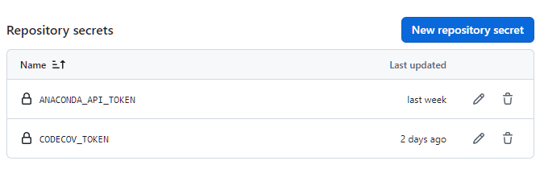
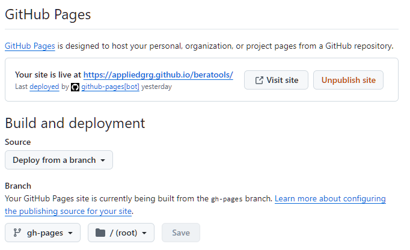
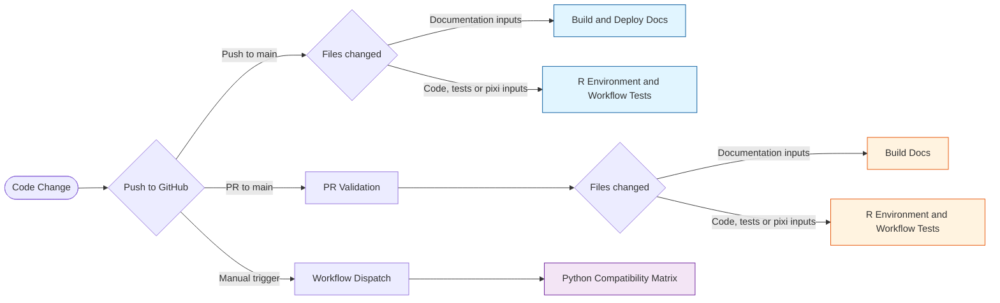
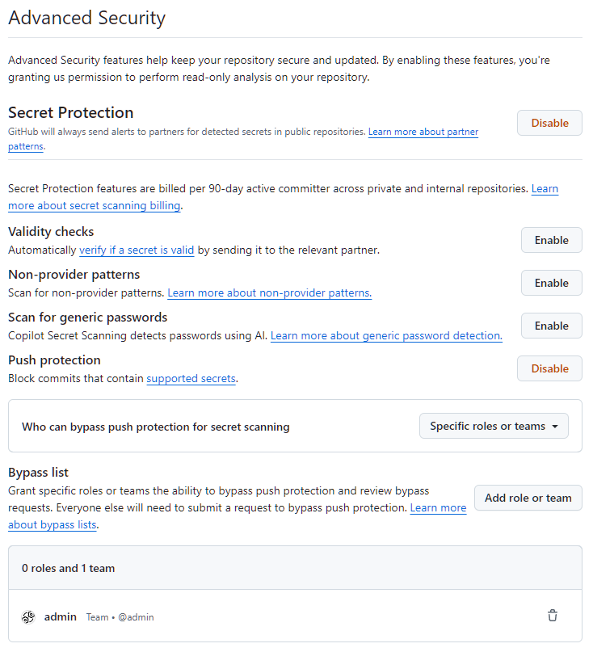
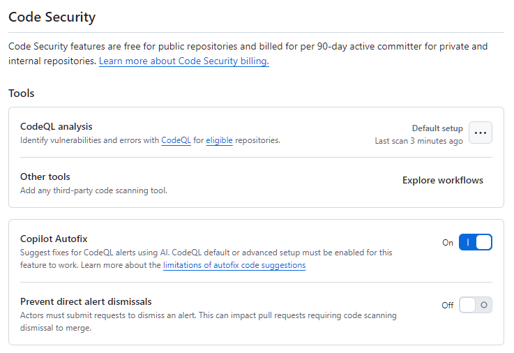

# Repository Maintainers

This document outlines the best practices and guidelines for maintainers of the PC2Products repository on GitHub. It covers:

- branch protection
- GitHub Actions workflows
- security features
- branching strategies

Maintainers play a crucial role in ensuring the quality and security of the codebase. Following these guidelines will help
to ensure a smooth and secure development process.

## Protect Branches

Branch protection rules help us enforce certain workflows in our repository. We can use them to:

- Apply protection to main branch
- Require pull requests before merging
- Require 1 approving review
- Require status checks (CI) to pass before merge
- Dismiss stale approvals when new commits are pushed
- Prevent force pushes and branch deletion (restrict to admins)
- Limit merge types (e.g., enable only squash merges to keep history clean)

## Actions

GitHub Actions allow you to automate workflows directly in our repository.
Here is a summary of the workflows in `.github/workflows`, grouped by trigger type:

### Documentation

- __mkdocs-gh-pages.yml__
    - Summary: Zensical validation and deployment workflow for the documentation.
    - Trigger: On pull requests and pushes to `main` that change `docs/`, `pyproject.toml` or the workflow.
    - One deployment runs at a time (`concurrency`); a newer push waits for the current deployment to finish.
    - Installs only `docs/files/requirements.txt` with pip, builds with Zensical on pull requests, and also deploys the generated `docs/site` to GitHub Pages on pushes.

### Automatic integration tests

- __python-integration-tests.yml__
    - Summary: R environment and workflow integration tests using Pixi and pytest.
    - Trigger: On pushes to `main` and pull requests targeting `main` that change `beratools/`, `tests/`, `pixi.toml`, `pixi.lock`, `pyproject.toml` or the workflow.
    - On Ubuntu, installs the system GDAL/GEOS/PROJ/udunits libraries, runs `tests/test_r_environment.py` (which installs the R packages into the pixi R), then `tests/test_workflow.py`, both with terminal coverage. The timeout is 60 minutes to leave room for compiling the R packages.

### Manual (workflow_dispatch)

- __python-compatibility-tests.yml__
    - Summary: Manual Python compatibility grid using tox inside micromamba environments with conda-forge GDAL.
    - Trigger: Manually triggered via `workflow_dispatch`.
    - Runs `tests/test_workflow.py` through tox under Python 3.12, 3.13, and 3.14.

### Configuration

There are security measures in place to restrict actions to be used. Find these in: Repository Settings -> Actions -> General --> Actions permissions:

Use repository secrets for sensitive information such as API tokens and credentials required by the workflows. Find these in: Repository Settings -> Secrets and variables -> Actions --> Repository secrets. Secret values must never be added to source control or documentation.

GitHub Pages must be set to deploy from GitHub Actions for the documentation workflow to publish the site:

### Actions Flow

## Secure our repository

Our repository uses GitHub's available security features to protect our code from vulnerabilities, unauthorized access, and other potential security threats. These features include:

- Dependabot alerts notify of security vulnerabilities in the dependency network, so that we can update the affected dependency to a more secure version.
- Secret scanning scans our repository for secrets (such as API keys and tokens) and alerts us if a secret is found, so that we can remove the secret from our repository.
- Push protection prevents we (and our collaborators) from introducing secrets to the repository in the first place, by blocking pushes containing supported secrets.
- Code scanning identifies vulnerabilities and errors in our repository's code, so that we can fix these issues early and prevent a vulnerability or error being exploited by malicious actors.

Find these settings in: Repository Settings -> Advanced Security

## Branching based workflow

To streamline collaboration, we recommend that regular collaborators work from a single repository, creating pull requests between branches instead of between repositories.

Forking is best suited for accepting contributions from people that are unaffiliated with a project, such as open-source contributors.

To maintain quality of main branch, while using a branching workflow, we use protected branches with required status checks and pull request reviews.
