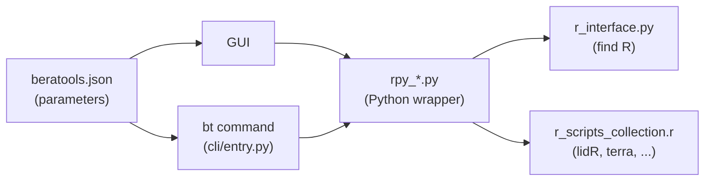

# Overview

## Project Layout

There are a number of files for build, test, and continuous integration in the root of the project, but in general, the
project is broken up like so.

```
├── beratools
│   ├── cli
│   ├── core
│   ├── gui
│   │   └── assets          # beratools.json: tool and parameter definitions
│   ├── tools               # rpy_*.py wrappers and r_scripts_collection.r
│   └── utility
├── docs
│   └── files
├── examples                # full_workflow.py, driven by Hydra
├── tests
│   └── data/LiDAR          # sample LAS tiles
```

Directory               | Description
----------------------- | -----------
`beratools/cli`         | The `bt` / `beratools` command (`entry.py`), with one subcommand per tool.
`beratools/core`        | Shared runtime: constants, logger and `tool_base`.
`beratools/gui`         | GUI components, and `assets/beratools.json`, which defines every tool and its parameters.
`beratools/tools`       | The PC2Products tools: a Python wrapper per tool (`rpy_*.py`), the R functions they call (`r_scripts_collection.r`), and the R helpers (`r_interface.py`, `r_common.py`).
`beratools/utility`     | Argument composition (`tool_args.py`), environment checks and spatial helpers.
`docs/files`            | User, developer and technical documentation.
`examples`              | `full_workflow.py`, which runs the LiDAR tools in sequence.
`tests`                 | Unit, integration and GUI tests, with sample data in `tests/data/LiDAR`.

## How a tool fits together



Start with [How to Add a New Tool](developer/add_new_tool.md) to add a tool, and
[Local Development](developer/development.md) to set up an environment.
