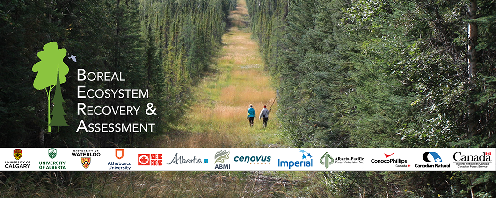

# About

**PC2Products** (Point Cloud to Products) is the BERA Tools category for turning LiDAR point clouds
(`.las` / `.laz`) into raster products such as a **DTM**, **DSM**, **CHM** and **hummock/hollow**
maps. It also includes tools for checking the input data, classifying ground points, mapping surface
water and depth to water, and comparing seismic lines with the surrounding peatland.

*Rasters produced from the sample tiles in `tests/data/LiDAR/` (ground-classified with CSF first, cell
size 0.3 m). Top: DTM and DSM, both built with TIN. Bottom: the hummock/hollow tool's two outputs,
using `Smooth_by = median`, `Min_ws = 3` and `lawn_range = 0.1`.*

Each tool is a thin Python wrapper in `beratools/tools/`. It validates the inputs and then calls an
R function in `r_scripts_collection.r` through [rpy2](https://rpy2.github.io/). The R functions use
[lidR](https://r-lidar.github.io/lidRbook/) to do the processing. The tools appear under the
**PC2Products** category in the BERA Tools GUI, and as subcommands of the `bt` command.

- [Overview](overview.md): the tools at a glance
- [User Guide](user_guide.md): typical workflow and how to run the tools
- [Technical Guide](technical_guide.md): how the tools run and how R is located

## Credit

PC2Products is part of BERA Tools, from the
[**Boreal Ecosystem Recovery and Assessment (BERA)**](http://www.beraproject.org/) Project, and is
developed by the [**Applied Geospatial Research Group**](https://www.appliedgrg.ca/).

## Reference

Surface Water Mapping, Depth-to-Water from Surface Water and Seismic Line Disturbance Analysis follow
Chan, Dabros & McDermid (2026),
[*Microtopographic and Hydrological Response to Repeated Seismic Line Disturbance in a Boreal Fen of
Northern Alberta, Canada*](https://doi.org/10.3390/f17040489), *Forests* 17, 489.
