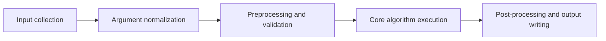
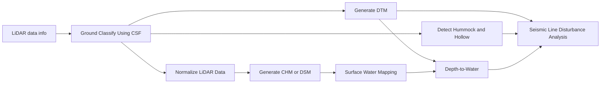

# Execution Pipeline

This page describes the high-level runtime flow from user input to final outputs.

## At a glance

## Pipeline stages

### 1) Input collection

**Purpose**

Capture tool parameters from the selected runtime interface.

**Main actions**

- GUI mode: parameters are collected from form widgets.
- CLI mode: parameters are parsed from command-line arguments.

**Inputs**

- User-provided tool parameters
- Runtime context (GUI/CLI)

**Outputs**

- Raw, mode-specific parameter payload

### 2) Argument normalization

**Purpose**

Build a consistent runtime argument set independent of call mode.

**Main actions**

- Tool metadata defines required/optional parameters.
- Framework options (`processes`, `call_mode`, `log_level`) are applied consistently.

**Inputs**

- Raw parameter payload
- Tool metadata/schema

**Outputs**

- Normalized tool kwargs ready for execution

### 3) Preprocessing and validation

**Purpose**

Verify that inputs are usable and compatible before expensive computation starts.

**Main actions**

- Check that the input folder exists and holds LAS/LAZ files, and create the output folder.
- Check that the R packages the tool needs are installed, and install any that are missing.

**Inputs**

- Normalized kwargs
- Source data files

**Outputs**

- Validated inputs and a ready R session
- Early validation errors (if any)

### 4) Core algorithm execution

**Purpose**

Run the selected tool’s core processing logic.

**Main actions**

- The tool wrapper sources `r_scripts_collection.r` and calls the tool's R function.
- The R function processes the `LAScatalog` tile by tile with parallel R workers.

**Inputs**

- Validated inputs
- Execution options (including `processes`)

**Outputs**

- One output per input tile (raster or point cloud)

### 5) Post-processing and output writing

**Purpose**

Finalize results and persist outputs for downstream use.

**Main actions**

- Merge per-tile rasters into a `Merged_*.tif` mosaic when there is more than one tile.
- Write tables and plots for the raster analysis tools.
- Emit logs/progress information.

**Inputs**

- Core algorithm outputs

**Outputs**

- Saved output datasets
- Runtime logs and progress signals

## Typical workflow chain

## Failure points to monitor

| Failure signal | Likely cause | Pipeline stage | Mitigation |
|---|---|---|---|
| Error finding R, or rpy2 fails to import | R not installed in the environment, or `R_HOME` points elsewhere | Preprocessing and validation | See [How R is located](../tool_behaviour.md#how-r-is-located); run from an activated environment |
| `R packages could not be installed` | No internet access, or missing system libraries on Linux | Preprocessing and validation | Run `tests/test_r_environment.py`; install the GDAL/GEOS/PROJ/udunits development libraries |
| Hummock/hollow stops without output, or a CHM comes out as a DSM | Input not ground-classified, or not height-normalized | Core algorithm execution | Run Ground Classify Using CSF, then Normalize LiDAR Data; check with LiDAR data info |
| Out of memory or very slow processing | Too many R workers for a small cell size | Core algorithm execution | Lower `processes`; the TIN and kriging DTM tools already halve the workers below a 1 m cell size |
| Missing CRS reported as `Unknown` | LAS files without a CRS | Preprocessing and validation | Assign the CRS to the LAS files before processing |

See also: [Tool Runtime Model](tool_runtime_model.md)
