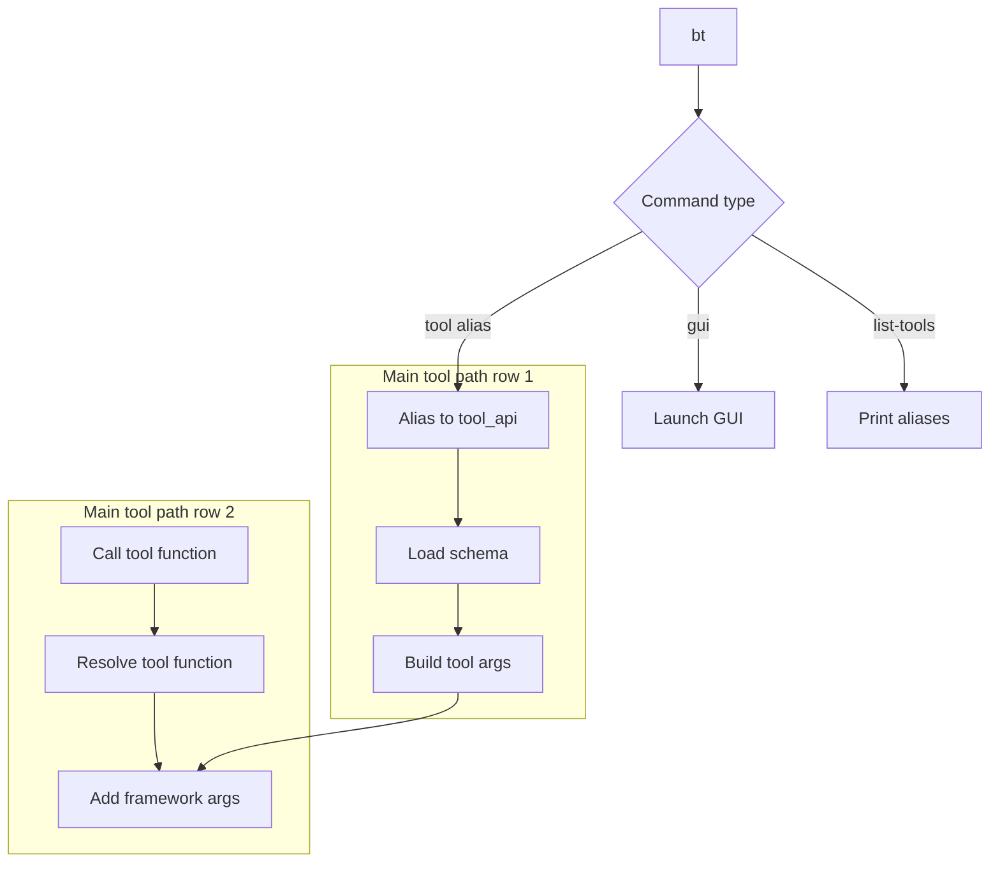

# Tool Runtime Model

This page describes how a PC2Products tool is executed across GUI and CLI.

## Tool API pattern

PC2Products tools expose a function shaped like:

```python
def rpy_tool_name(in_las_folder, out_folder, ..., processes=0, **kwargs)
```

`processes` is shared across tools; the other framework arguments (`call_mode`, `log_level`) arrive
through `**kwargs`. Each module calls `configure_r_environment()` before it imports rpy2, so that R can
be found (see [How R is located](../tool_behaviour.md#how-r-is-located)).

## Argument composition

`compose_tool_kwargs` reads tool metadata and creates runtime kwargs for each mode:

- **GUI mode**: tool parameters are bundled from the GUI payload.
- **CLI mode**: required/optional parameters are parsed as command-line args.
- **Module mode**: direct Python function call with explicit arguments.

This keeps tool definitions synchronized between GUI and CLI while avoiding duplicated parameter schemas.

## CLI subcommand dispatch model

The `bt` CLI (also available as `beratools`) uses a unified subcommand entry point (`beratools/cli/entry.py`) and dispatches commands in three groups:

- **GUI command**: `bt gui`
- **Utility command**: `bt list-tools`
- **Tool commands**: short aliases (for example `dtm`, `chm_dsm`, `hh`) mapped to internal `tool_api` names (`rpy_dtm_by`, `rpy_CHM_DSM_by`, `rpy_PC2hummock_hollow`)

### Dispatch flow



Node legend:

1. **Load schema**: load tool parameter metadata from `gui/assets/beratools.json`.
2. **Build tool args**: create required/optional CLI arguments from metadata.
3. **Add framework args**: append `--processes`, `--call_mode`, and `--log_level`.
4. **Resolve tool function**: map `tool_api` to function under `beratools.tools.*`.
5. **Call tool function**: execute the selected tool with parsed arguments.

### Alias and argument model

- Alias mapping is defined in `TOOL_ALIASES`.
- Tool parameter definitions (required/optional flags, defaults, choices, numeric/list typing) come from `gui/assets/beratools.json`.
- Shared runtime flags are added to every tool command:
  - `--processes`
  - `--call_mode`
  - `--log_level`

This keeps CLI behavior aligned with GUI metadata while preserving a concise command surface.

### Example commands

```bash
bt list-tools
bt dtm
bt dtm --in_las_folder tests/data/LiDAR --out_folder tests/data/LiDAR/Raster_Output --style tin --processes 4
```

## Parallel processing model

PC2Products tools do their parallel work in R, not in Python:

- `r_common.r_processes(processes)` turns the requested `processes` into an R worker count. `0` or
  less means every CPU core; the count is capped at the number of cores, at 8, and by available memory.
- The R function runs `future::plan(multisession, workers = rprocesses)` and processes the
  `LAScatalog` tile by tile.
- The tools' R output streams to the console, or to the GUI log when the GUI runs the tool.

See [How all the tools behave](../tool_behaviour.md#how-all-the-tools-behave) for the details.

## Separation of concerns

- `beratools/tools/rpy_*.py`: input validation, R package checks and dispatch
- `beratools/tools/r_scripts_collection.r`: the processing, with lidR, terra and the other R packages

This structure keeps tool wrappers small and keeps the processing in one R file.

See also: [How to Add a New Tool](../../developer/add_new_tool.md)
