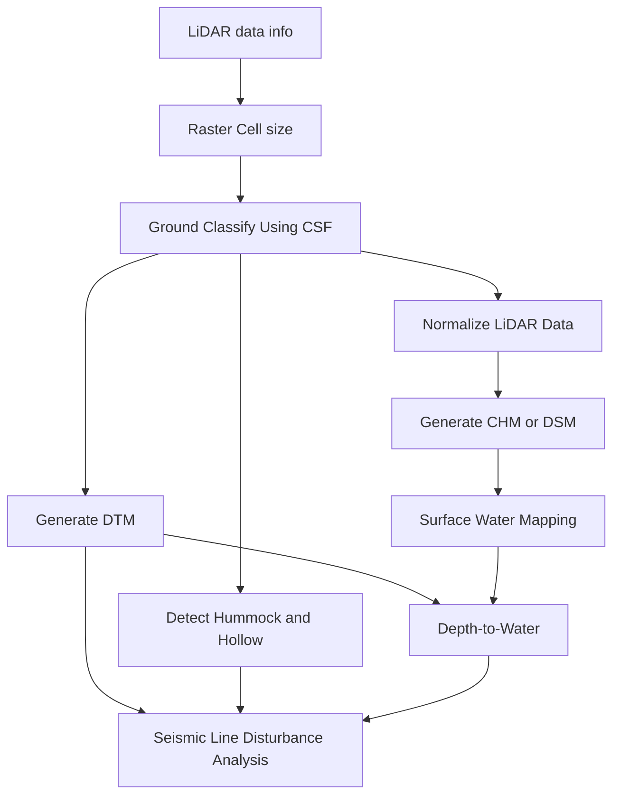

# Quick Start

Make sure [PC2Products is installed](user/installation.md), activate the environment, and start the
BERA Tools GUI. The tools are under the **PC2Products** category.

```bash
conda activate PC2Products
bt gui        # or, with pixi: pixi run main
```

## Example Data

Sample LiDAR tiles are in `tests/data/LiDAR/`. The examples on each tool page use them.

## Typical workflow



1. **[LiDAR data info](user/las_info.md)**: check the CRS, extent, density and whether the data is
   height-normalized.
2. **[Raster Cell size from LiDAR data](user/cellsize.md)**: preview the cell size that the raster
   tools will use.
3. **[Ground Classify Using CSF](user/gnd_csf.md)**: classify ground points if the data isn't
   ground-classified yet.
4. **[Generate DTM from LiDAR Data](user/dtm.md)**: build the bare-earth terrain model.
5. **[Normalize LiDAR Data](user/normalize.md)**: subtract the terrain from the point cloud, so that
   Z is height above ground.
6. **[Generate CHM or DSM from LiDAR Data](user/chm_dsm.md)**: build a CHM from the normalized
   tiles, or a DSM from the original tiles.
7. **[Detect Hummock and Hollow from LiDAR Data](user/hummock_hollow.md)**: map micro-topography from
   the ground-classified data.
8. **[Surface Water Mapping](user/surface_water.md)**: map surface water from a true-colour
   orthomosaic.
9. **[Depth-to-Water from Surface Water](user/dtw.md)**: krige a water table from the surface water
   and compute depth to water.
10. **[Seismic Line Disturbance Analysis](user/seismic_line_analysis.md)**: compare seismic lines
    with the surrounding peatland, using the DTM, hummock/hollow and depth-to-water rasters.

## Running the tools

=== "GUI"

    Select a tool under **PC2Products**, fill in the parameters and click **Run**. The R output
    streams into the log while the tool runs.

    

=== "bt command"

    ```bash
    bt list-tools                       # list the tool subcommands
    bt dtm                              # show the parameters for one tool
    bt dtm --in_las_folder <las_dir> --out_folder <out_dir> --style tin -p 4
    ```

    `bt` reads each tool's parameters from `beratools.json`, converts values to the right type and
    rejects anything that isn't one of a list parameter's allowed values.

=== "Python module"

    ```bash
    python -m beratools.tools.rpy_dtm_by --in_las_folder <las_dir> --out_folder <out_dir> --style tin
    ```

    `-p/--processes` sets the requested number of workers, and `-l/--log_level` sets the log level.

## Building a pipeline

The **Pipeline** tab, next to **Tool history** in the GUI, chains tools together so they run one
after another, without writing a script.

1. **Add steps**: drag tools from **Tools available** into the Pipeline tab. Dragging over the tab
   switches to it. You can also select a tool and click the add button. Drag steps, or use the arrow
   buttons, to change their order.
2. **Set each step's parameters**: click a step to open its parameters in the tool form. Your changes
   are kept in the step.
3. **Link steps**: **Inputs from earlier steps** sets which earlier step each input reads from, with one
   choice per input:
    - a LiDAR folder (`in_las_folder`) can come from **Ground Classify Using CSF** or
      **Normalize LiDAR Data**;
    - a raster such as `in_dtm`, `in_microform`, `in_chm`, `in_water` or `in_dtw` can come from the
      step that makes it. When the pipeline runs, the step reads that step's `Merged_*` mosaic, or its
      single-tile raster if there is only one tile.

    Each input links to the latest earlier step that makes what it needs, and the links are reset
    this way whenever a step is added or moved, replacing any you chose by hand. Linked fields are
    greyed out in the form and show what they will read, for example `D:/rasters/Merged_*_DTM.tif`. Choose
    **Its own value** to use the path in the form instead. The list shows each step's links, for
    example `4. Seismic Line Disturbance Analysis ← steps 2, 3`.
4. **Run**: click **Run Pipeline**. The steps run in order with the CPU cores set by the slider, and
   their output streams into the log. The pipeline stops if a step fails, if a linked file is
   missing, or if you click **Cancel**.

For example, add **Ground Classify Using CSF**, **Generate DTM from LiDAR Data**,
**Detect Hummock and Hollow from LiDAR Data** and **Seismic Line Disturbance Analysis**. The DTM and
hummock/hollow steps link to the classified tiles, and the seismic analysis links its `in_dtm` and
`in_microform` to their rasters. You only set the first step's input folder and each step's output
folder.

### Saving and running a pipeline without the GUI

The buttons above the list save and load pipelines as `.json` files. A saved pipeline also runs from
the command line, from the repository root:

```bash
python -m beratools.core.pipeline my_pipeline.json --processes 4
```

!!! note
    A step only counts as failed if its tool exits with an error. Some tools print a warning and
    stop normally instead, for example **Generate DTM from LiDAR Data** on data that isn't
    ground-classified. The next step then fails on its missing input, so check the log.

Which inputs can link to which outputs is set in `beratools.json`, so new tools can join pipelines
without code changes. See [Taking part in pipelines](developer/add_new_tool.md#taking-part-in-pipelines).

## Example workflow script

`examples/full_workflow.py` runs the LiDAR steps of the typical workflow in one go, driven by
[Hydra](https://hydra.cc/) and `examples/config.yaml`. Run it from the repository root:

```bash
python examples/full_workflow.py           # run every step on the sample tiles
python examples/full_workflow.py processes=4 DATA_DIR=D:/my_data/LiDAR
python examples/full_workflow.py steps_to_run=[dtm,chm_dsm] args_chm_dsm.style=pitfree
```

## Troubleshooting

- **The first run is slow**: each tool installs the R packages it needs into the environment's R the
  first time. See [How all the tools behave](technical/tool_behaviour.md#how-all-the-tools-behave).
- **R can't be found**: see [How R is located](technical/tool_behaviour.md#how-r-is-located).
- **Windows, GDAL DLL errors**: run the tools from an *activated* environment.
- **Windows, rpy2 `IndexError` in `rpy2/situation`**: with R from `C:\Program Files\R` and rpy2
  installed by pip, run the tools from PowerShell or cmd, not Git Bash.
